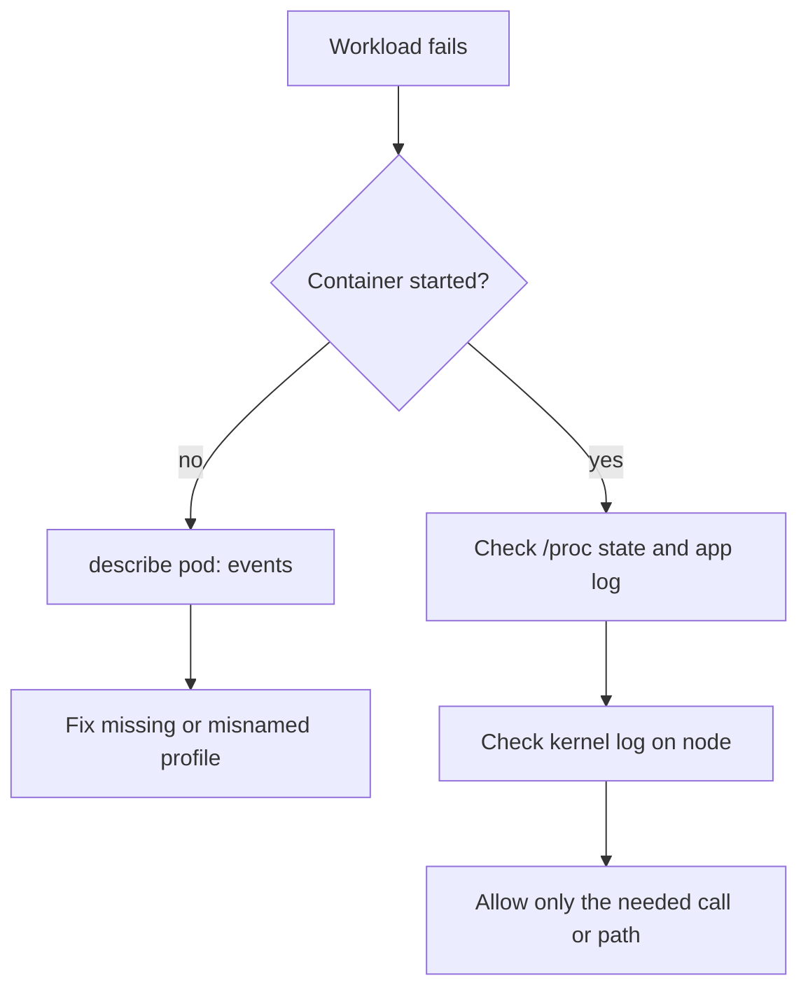

# Diagnosing Profile Failures

A profile that works is invisible, and a profile that fails shows up as a pod that does not start or an application that reports a vague permission error. The correct response is to find which boundary caused the failure and fix that boundary. The wrong response is to set `Unconfined` and move on, because that removes the protection together with the error. This part shows the symptoms of each failure and the order in which to check them.

## Two kinds of failure

The first kind prevents the container from starting. The kubelet or the runtime cannot find the profile or cannot apply it. The pod stays in a state such as `CreateContainerError`, `Blocked` or `ContainerCreating`, and the cause is in the events of the pod. The second kind happens while the application runs. The profile loaded fine, and the application calls something the profile denies. The container starts and then logs errors such as `Operation not permitted` or `Permission denied`, and the cause is in the kernel and in the application log.

## Start with the pod

The first tool for the first kind is the event list of the pod. Select the environment:

<!-- astrona:playground:renew -->

```sh
export KUBECONFIG="$(astrona kubeconfig ats-033-playground-040-01)"
test "$(kubectl config current-context)" = "kind-astro-ats-033-playground-040-01" || exit 1
```

Create a pod that references a seccomp profile that does not exist on the node. Save this as `pod-seccomp-missing.yaml`:

```yaml
apiVersion: v1
kind: Pod
metadata:
  name: seccomp-missing
  namespace: starfleet
spec:
  restartPolicy: Never
  securityContext:
    seccompProfile:
      type: Localhost
      localhostProfile: profiles/does-not-exist.json
  containers:
  - name: shell
    image: docker.io/library/busybox:1.37.0
    command:
    - sh
    - -c
    - sleep 3600
```

Apply it and read the state:

```sh
kubectl apply -f pod-seccomp-missing.yaml
kubectl -n starfleet get pod seccomp-missing
kubectl -n starfleet describe pod seccomp-missing
```

The pod does not reach `Running`. The status column shows an error state such as `CreateContainerError`. The `Events` section at the end of the `describe` output contains a warning from the kubelet whose message says that the seccomp profile could not be loaded and names the file. The file name in the message is the quickest way to see a typo or a missing copy on this node.

The fix keeps the protection. Copy the correct profile to the node, or correct `localhostProfile`, and recreate the pod. Do not replace the type with `Unconfined`. Remove the failed pod when you are done:

```sh
kubectl -n starfleet delete pod seccomp-missing
```

An AppArmor profile that is not loaded behaves the same way for the first kind. The pod does not start, and the events name the profile and say that it is not loaded on the node. The fix is to run `apparmor_parser -r` for the profile on that node, or to schedule the pod on a node that has it.

## Then the kernel

For the second kind, the application started and something is denied. Work in this order:

1. Read what is applied to the process. For seccomp, check `Seccomp:` in `/proc/1/status`. For AppArmor, read `/proc/1/attr/current` inside the container, which shows the profile name and mode or `unconfined`.
2. Read the application log with `kubectl logs`. A seccomp denial usually shows as `Operation not permitted` on a call that has nothing to do with file permissions. An AppArmor denial shows as `Permission denied` on a path where the file mode would allow access.
3. Look at the kernel log on the node. AppArmor denials are logged with the text `apparmor="DENIED"` and the profile and path. Seccomp filters log only when the profile uses `SCMP_ACT_LOG`, or the system audit records them. On a `kind` node the kernel log belongs to the machine that runs Podman, so read it with `dmesg` or `journalctl -k` on that machine.
4. Change the profile as little as possible. Allow the one syscall, or the one path, that the application needs, and keep the rest denied.

To find the syscalls that a program needs, run it under a profile with `SCMP_ACT_LOG` as the default action, or use `strace` in a test environment, and collect the names. For AppArmor, switch the profile to complain mode with `aa-complain`, run the application and read the logged events. Then turn enforcement back on with `aa-enforce`.



The diagram shows the decision: a container that did not start is a profile delivery problem, and a container that started is a profile content problem.

## Overrides and where to look

If the wrong profile applies, check the fields in order. A container-level `securityContext` overrides the pod-level one, so inspect both:

```sh
kubectl -n starfleet get pod restricted-reader -o jsonpath='{.spec.securityContext.seccompProfile}{"\n"}{.spec.containers[0].securityContext.seccompProfile}{"\n"}'
```

The command needs a pod that exists. Replace `restricted-reader` with the name of any running pod, and an empty line means that the field is not set at that level. Pods that were created before a change of a Deployment template keep their old settings, so after a fix, recreate the pods through the controller with `kubectl rollout restart`.

You have followed the full path of kernel hardening: choose the filter, deliver it to the nodes, reference it in the securityContext and verify it from inside the container. When something fails, the pod's events or the kernel log name the cause, and the fix narrows the profile and never removes it.

## Common pitfalls

> [!WARNING]
> - **Switching to `Unconfined` to make the error go away.** That removes the protection for the whole pod. Allow the specific call or path instead.
> - **Ignoring the pod events.** For a pod that does not start, the `describe` output names the profile and the cause.
> - **Fixing one node of several.** The profile must exist on every node where the pod can run, or the same pod fails on the next node.
> - **Forgetting container-level overrides.** A value on the container replaces the pod value. Read both levels.
> - **Debugging a rollout without restarting pods.** Existing pods keep the old settings until the controller replaces them.
