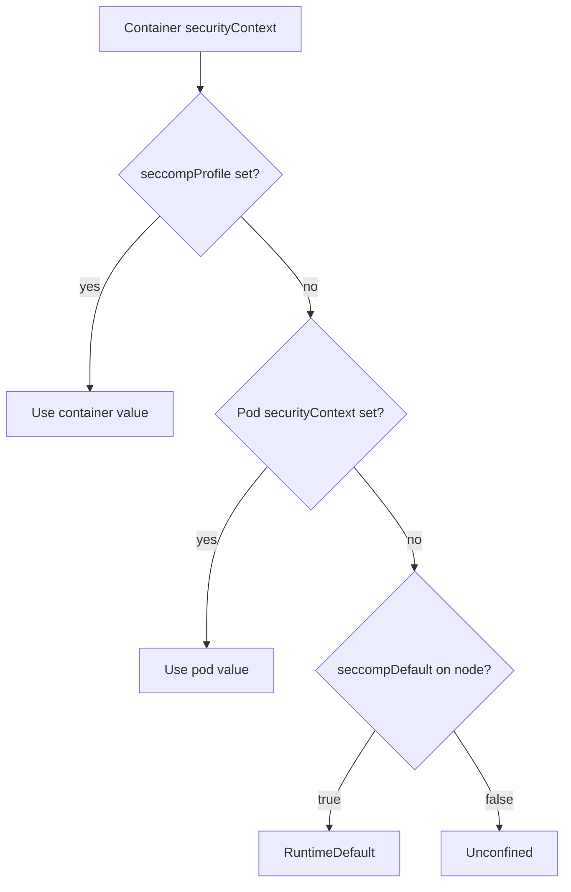

# Profile Types, Locations And The Unconfined Risk

Every pod starts as a Linux process that shares the kernel of its node. If that process may call every syscall, then every flaw in a rarely used kernel feature is reachable from inside the container. A seccomp profile shrinks that reachable surface before the application starts. This part explains who installs the filter, which three profile types exist, where the kubelet looks for a profile file, and what you give up when a pod runs unfiltered.

## Who installs the filter

A filter is installed in the process itself. The container runtime (containerd in a `kind` node) builds the profile from the pod specification and passes it to the low-level runtime `runc`. `runc` loads the filter into the kernel just before it starts the application. From that moment the kernel checks every syscall of that process and of all its children. The process can add stricter filters, but it can never remove one, so the application cannot lift the restriction that the runtime placed on it.

The kubelet is the node agent that starts the pod. It does not filter anything itself. Its jobs are to find the profile file for a `Localhost` profile, to pass the profile to the runtime, and to apply the node-wide default when a pod chooses nothing. The seccomp filter never looks at file names or addresses. It decides on the syscall number and on its numeric arguments only.

## The three profile types

The field `seccompProfile` in a `securityContext` selects the profile. It exists at pod level, where it applies to every container, and at container level, where it overrides the pod value for that container.

- `RuntimeDefault` uses the default profile that ships with the container runtime. It denies a list of syscalls that are dangerous or that normal applications do not need, and it allows the rest. It is the correct starting point for almost every workload.
- `Localhost` uses a profile file that exists on the node. The field `localhostProfile` names the file relative to the kubelet seccomp directory.
- `Unconfined` installs no filter. The process may call every syscall that the kernel offers.

The kubelet seccomp directory is `/var/lib/kubelet/seccomp` unless the kubelet is started with another root directory. A `localhostProfile` value is always relative to it. If the file is `/var/lib/kubelet/seccomp/profiles/audit.json`, the value is `profiles/audit.json`. A value with a leading slash is an absolute path and the kubelet does not accept it as a profile name.

A pod that sets no `seccompProfile` does not automatically get `RuntimeDefault`. Without the kubelet setting `seccompDefault: true`, the pod runs as `Unconfined`. With that setting, the kubelet applies `RuntimeDefault` to every container that has no profile of its own. The setting is a kubelet option, so each node needs it, and a cluster can have nodes where it is on and nodes where it is off.



The diagram shows the order in which the kubelet picks the profile: container value first, pod value second, node default last.

## What Unconfined costs

`Unconfined` is the lack of a restriction, not a neutral setting. A kernel vulnerability in a syscall that `RuntimeDefault` would have denied becomes reachable from the container. A container that runs as `privileged: true` also runs without a filter, because a privileged container is allowed to change the node and the runtime does not apply the default profile to it. Pod Security Admission reflects this. The `baseline` level rejects an explicit `Unconfined` profile, and the `restricted` level accepts only `RuntimeDefault` or `Localhost`.

The cost of a filter is small. `RuntimeDefault` was designed to keep ordinary applications working, so adding it rarely breaks anything. A pod that fails under `RuntimeDefault` is unusual, and the reason is a syscall the application needs that the default list denies. The right answer then is a `Localhost` profile that allows that one syscall, not `Unconfined`.

## Compare the three types on a node

You will start three pods that differ only in the profile and read the process state of each. Select the environment first:

<!-- astrona:playground:renew -->

```sh
export KUBECONFIG="$(astrona kubeconfig ats-033-playground-040-02)"
test "$(kubectl config current-context)" = "kind-astro-ats-033-playground-040-02" || exit 1
node_name="astro-ats-033-playground-040-02-control-plane"
```

First check whether the kubelet of this node applies a default. The kubelet configuration is a file on the node. If the command prints nothing, the setting is not present and its default `false` applies:

```sh
podman exec "$node_name" grep -i seccompDefault /var/lib/kubelet/config.yaml
```

Save this as `pods-seccomp-types.yaml`:

```yaml
apiVersion: v1
kind: Pod
metadata:
  name: seccomp-runtime
  namespace: starfleet
spec:
  restartPolicy: Never
  securityContext:
    seccompProfile:
      type: RuntimeDefault
  containers:
  - name: shell
    image: docker.io/library/busybox:1.37.0
    command:
    - sh
    - -c
    - sleep 3600
---
apiVersion: v1
kind: Pod
metadata:
  name: seccomp-unset
  namespace: starfleet
spec:
  restartPolicy: Never
  containers:
  - name: shell
    image: docker.io/library/busybox:1.37.0
    command:
    - sh
    - -c
    - sleep 3600
---
apiVersion: v1
kind: Pod
metadata:
  name: seccomp-privileged
  namespace: starfleet
spec:
  restartPolicy: Never
  containers:
  - name: shell
    image: docker.io/library/busybox:1.37.0
    command:
    - sh
    - -c
    - sleep 3600
    securityContext:
      privileged: true
```

Apply it and wait for the pods:

```sh
kubectl apply -f pods-seccomp-types.yaml
kubectl -n starfleet wait --for=condition=Ready pod/seccomp-runtime pod/seccomp-unset pod/seccomp-privileged --timeout=120s
```

Then read the `Seccomp` line of the main process in each pod:

```sh
for pod_name in seccomp-runtime seccomp-unset seccomp-privileged; do
  printf '%s: ' "$pod_name"
  kubectl -n starfleet exec "$pod_name" -- grep Seccomp: /proc/1/status
done
```

The line `Seccomp:` shows the mode of the process. `0` means no filter, `1` means the old strict mode and `2` means a filter is installed. The pod `seccomp-runtime` reports `2`, because the runtime installed its default filter. The pod `seccomp-privileged` reports `0`, because a privileged container runs unfiltered. The pod `seccomp-unset` follows the node default that you read above: it reports `0` when the kubelet has no `seccompDefault: true`, and `2` when it has.

You can also read what the API server stored, which is the value the kubelet resolves. For the unset pod the field is empty, which proves that the filter, when present, came from the kubelet default and not from the pod:

```sh
kubectl -n starfleet get pod seccomp-unset -o jsonpath='{.spec.securityContext.seccompProfile}{"\n"}'
```

Remove the pods when you are done:

```sh
kubectl -n starfleet delete pod seccomp-runtime seccomp-unset seccomp-privileged
```

## Where Localhost profiles live

A `Localhost` profile is a plain file on each node, under the directory you saw above. The kubelet reads it when it creates the container. If the file is missing on the node that runs the pod, the container does not start. This makes node preparation part of the work: the file must be placed on every node where the pod can be scheduled, and a new or replaced node must receive it before pods that need it arrive. The next part writes such a file and places it on the node.

You now know the three profile types, the order in which the kubelet resolves them and the reason a missing profile is a risk rather than a convenience. The open question is what a profile file contains and how to write one.

## Common pitfalls

> [!WARNING]
> - **Assuming a pod without `seccompProfile` is filtered.** Only the kubelet setting `seccompDefault: true` adds `RuntimeDefault` for such a pod.
> - **Writing an absolute path in `localhostProfile`.** The value is relative to `/var/lib/kubelet/seccomp`.
> - **Treating `privileged: true` as a filtered container.** A privileged container runs without a seccomp filter.
> - **Setting `Unconfined` to silence one error.** It removes the protection for every syscall, not for the one that failed.
> - **Setting the profile at pod level and forgetting a container override.** A container-level value replaces the pod value.
