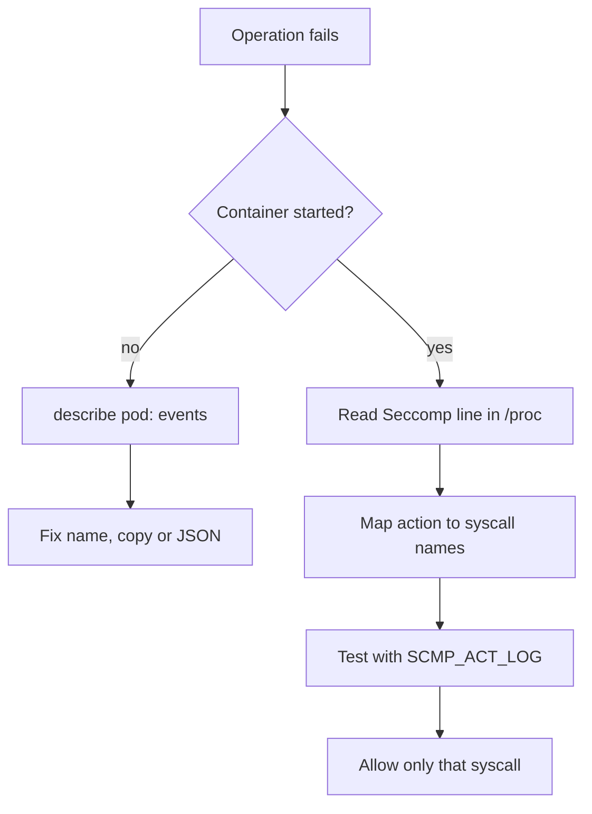

# Find Blocked Syscalls And Fix Failures

A seccomp profile fails in two different ways. Either the container never starts, or it starts and a later operation returns an error that looks like a permission problem. Both look alike to someone who does not know where to look, and the usual wrong reaction is to set `Unconfined`. This part shows how to tell the two failures apart, how to find the syscall that a profile blocked, and how to repair the pod without removing the filter.

## Failure before start: the profile cannot be loaded

When the kubelet cannot find or parse the profile, the container is never created. The pod stays in a state such as `CreateContainerError`, and the reason is in the events of the pod. The component that reports it is the kubelet, because it resolves `localhostProfile` against `/var/lib/kubelet/seccomp` before it asks the runtime to create the container. A wrong file name, a missing copy on this node and invalid JSON all end here.

Select the environment:

<!-- astrona:playground:renew -->

```sh
export KUBECONFIG="$(astrona kubeconfig ats-033-playground-040-02)"
test "$(kubectl config current-context)" = "kind-astro-ats-033-playground-040-02" || exit 1
node_name="astro-ats-033-playground-040-02-control-plane"
```

Save this as `pod-seccomp-typo.yaml`. The file name in `localhostProfile` has a typo on purpose:

```yaml
apiVersion: v1
kind: Pod
metadata:
  name: seccomp-typo
  namespace: starfleet
spec:
  restartPolicy: Never
  securityContext:
    seccompProfile:
      type: Localhost
      localhostProfile: profiles/block-renam.json
  containers:
  - name: shell
    image: docker.io/library/busybox:1.37.0
    command:
    - sh
    - -c
    - sleep 3600
```

Apply it and look at the state and the events:

```sh
kubectl apply -f pod-seccomp-typo.yaml
kubectl -n starfleet get pod seccomp-typo
kubectl -n starfleet describe pod seccomp-typo
```

The pod does not become `Running`. In the `Events` section at the end of the `describe` output, the kubelet reports a warning that names the profile file it could not use. Compare that name with the files on the node:

```sh
podman exec "$node_name" ls /var/lib/kubelet/seccomp/profiles
```

If the directory does not exist yet in your playground, the error is the same: the file is missing. The repair keeps the protection. Correct the name in the pod specification, or copy the correct profile into place, and then recreate the pod, because a pod specification cannot be edited to change the security context of a running pod. Remove the failed pod:

```sh
kubectl -n starfleet delete pod seccomp-typo
```

## Failure after start: a syscall is blocked

When the container runs and one operation fails, the profile loaded correctly and blocks a call that the application makes. The typical sign is `Operation not permitted` (error `EPERM`) on an operation that the file permissions would allow. The process is usually root or owns the file, so the permission bits are not the cause. A second sign is that the same operation works in another pod with `RuntimeDefault` or `Unconfined`.

Three steps find the cause, in this order.

1. Read the profile that applies. Check the `Seccomp:` line in `/proc/1/status` inside the container: `2` means a filter. Read the stored specification with `kubectl get pod -o jsonpath` at both pod and container level, because the container value wins.
2. Map the failing operation to a syscall. The command that failed names the action (rename, change owner, mount), and each action has a small set of syscall names. Compare them with the `names` lists in the profile.
3. Confirm with a log. Change the rule action from `SCMP_ACT_ERRNO` to `SCMP_ACT_LOG` in a test copy of the profile and run the application again. The kernel then records each matching call and lets it run. On a Linux host, those records appear in the kernel log or the audit log with the text `type=SECCOMP` and a `syscall=` number. A `kind` node uses the kernel of the machine that runs Podman, so you read the log on that machine, and your access to it depends on that machine.

A second method gives the full list at once. Run the application in a test environment under `strace -f -c`, which counts every syscall the program makes, and build the allow list from the names it prints. Use real traffic and all code paths, because a path that the trace never touched stays blocked by an allow list. Any list you derive this way is a record of one run, not a proof of what the program may need.



The diagram shows the two branches: a container that did not start is a delivery problem, and a container that did start is a content problem.

## Repair without removing the filter

Suppose a pod that runs under a profile blocking `rename`, `renameat` and `renameat2` must now be allowed to rename files in one maintenance job. The wrong repair is `Unconfined`, which opens every syscall. The right repair is the smallest change that fixes the need. If the pod needs rename for its whole life, remove the three names from the rule. If only one job needs it, run that job in a second pod with its own profile, so the main workload keeps the stricter one.

The following profile, saved as `log-all.json`, is only for investigation. It allows every call and asks the kernel to log each one, and you replace it with a stricter file once you know the names:

```json
{
  "defaultAction": "SCMP_ACT_LOG"
}
```

The profile has no `syscalls` list, so the default action applies to every call. Used on a test pod, it shows which syscalls the application makes in the kernel or audit log without blocking any of them. How many entries appear depends on the host, so expect a long log. The step after the investigation is to turn the recorded names into an `SCMP_ACT_ALLOW` list and change the `defaultAction` to `SCMP_ACT_ERRNO`.

You now follow the full path of a seccomp failure. A pod that does not start has a delivery problem that its events name. A pod that starts and is denied has a content problem that you trace to a syscall name. In both cases the fix narrows the profile and never removes it.

## Common pitfalls

> [!WARNING]
> - **Reading the application log first for a pod that never started.** There is no log. The pod events name the profile problem.
> - **Blaming file permissions for `Operation not permitted` as root.** A root process that is denied is often blocked by a seccomp rule.
> - **Fixing one node and not the others.** The same pod fails on the next node that lacks the profile file.
> - **Leaving `SCMP_ACT_LOG` as the default in production.** It logs and allows every call, so it protects nothing.
> - **Building an allow list from a short test.** Syscalls used only in rare code paths stay blocked.
