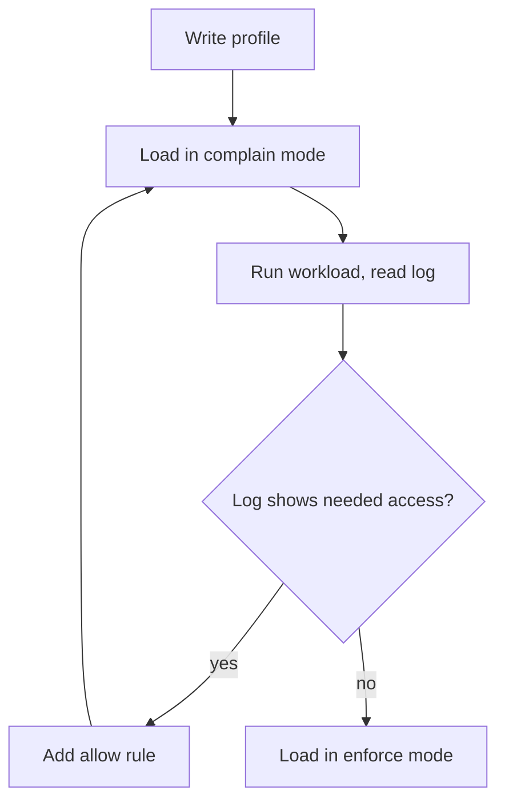

# AppArmor Modes And Loading Profiles

Seccomp decides which syscalls a process may call, but it cannot decide which file the call opens. A process that is allowed to call `openat` can open any file its user can reach. AppArmor closes that gap. This part explains what AppArmor is, how a profile looks, the difference between enforce and complain mode, and how a profile gets into the kernel of a node.

## What AppArmor is

AppArmor is a Linux security module (LSM), a part of the kernel that checks access rules on top of normal file permissions. A rule set for one program is a **profile**. The profile lists the files and directories the program may read, write or execute, the Linux capabilities it may use and the network operations it may do. Anything the profile does not allow is denied, even for root, and the process cannot change that. This is called mandatory access control. The normal file permissions are discretionary: the owner of a file decides. Under AppArmor the profile decides, and the owner cannot override it.

The kernel enforces AppArmor, not Kubernetes. The kubelet and the container runtime only tell the kernel which profile a process runs under. A profile has to be loaded into the kernel first, and the kernel then attaches it to the process when the runtime starts the container.

## A profile file

A profile is a text file. This one allows all file, network and capability use and denies writes under `/tmp`:

```text
#include <tunables/global>

profile k8s-deny-tmp-write flags=(attach_disconnected) {
  #include <abstractions/base>

  file,
  network,
  capability,

  deny /tmp/** w,
}
```

The word after `profile` is the profile name. This name, and not the file name, is what a pod uses to refer to the profile. The lines `file,`, `network,` and `capability,` allow those groups of operations. The line `deny /tmp/** w,` forbids writing to any path below `/tmp`, and a `deny` rule wins over an allow rule. The flag `attach_disconnected` lets the profile apply to files that a container sees under a path different from the host path, which is needed for container filesystems.

## Enforce mode and complain mode

A loaded profile runs in one of two modes.

- In **enforce** mode, the kernel blocks every operation the profile does not allow and writes an audit message for it. This is the mode for production.
- In **complain** mode, the kernel allows the operation and only writes the audit message. This is the mode for writing a profile: you run the application, read what the profile would have denied and add rules until the log is quiet.

The mode is a property of the loaded profile. You can set it in the file with `flags=(complain)`, or switch it later with the tools below. The same file can be loaded in either mode, so a profile in complain mode can move to enforce mode without a rewrite.



The diagram shows the usual way to build a profile: loop in complain mode until the log shows only unwanted access, then enforce.

## The tools and where the kernel reports

- `apparmor_parser -r <file>` loads a profile into the kernel, or replaces the version that is already loaded. The option `-C` loads it in complain mode, and `-R` removes it.
- `aa-status` lists the loaded profiles by mode and the processes that run under them.
- `aa-complain <file>` and `aa-enforce <file>` change the mode of a profile.
- `/sys/module/apparmor/parameters/enabled` contains `Y` when the module is active in the kernel.
- `/sys/kernel/security/apparmor/profiles` lists the loaded profiles with their mode in parentheses.

Audit messages from the kernel contain `apparmor="DENIED"` in enforce mode and `apparmor="ALLOWED"` in complain mode, followed by the profile name and the path. They appear in the kernel log or the audit log of the machine whose kernel runs the node.

## Check the node and load a profile

Select the environment and define a helper that runs a command in the node:

<!-- astrona:playground:renew -->

```sh
export KUBECONFIG="$(astrona kubeconfig ats-033-playground-040-03)"
test "$(kubectl config current-context)" = "kind-astro-ats-033-playground-040-03" || exit 1
node_name="astro-ats-033-playground-040-03-control-plane"
run_on_node() { podman exec "$node_name" "$@"; }
```

Ask the kernel whether AppArmor is active:

```sh
run_on_node cat /sys/module/apparmor/parameters/enabled
```

The answer `Y` means AppArmor is active. If the file does not exist or contains `N`, the kernel of your machine has no AppArmor. Then the loading steps below do not work in your playground, and the rest of this part is reading. That is normal on machines with another security module such as SELinux. It does not mean the playground is broken.

If AppArmor is active, check that the node has the loader tool:

```sh
run_on_node which apparmor_parser
```

If the command prints a path, save the profile above as `k8s-deny-tmp-write` and load it. The first command copies the file into the node and the second loads it:

```sh
podman cp k8s-deny-tmp-write "$node_name:/etc/apparmor.d/k8s-deny-tmp-write"
run_on_node apparmor_parser -r /etc/apparmor.d/k8s-deny-tmp-write
```

Then read the list of loaded profiles. The profile `k8s-deny-tmp-write` appears with the mode `enforce`:

```sh
run_on_node grep k8s-deny-tmp-write /sys/kernel/security/apparmor/profiles
```

Reload the same file in complain mode with `-C`, and read the list again. The mode in parentheses changes to `complain`, and the same file is now only logged, not blocked:

```sh
run_on_node apparmor_parser -r -C /etc/apparmor.d/k8s-deny-tmp-write
run_on_node grep k8s-deny-tmp-write /sys/kernel/security/apparmor/profiles
```

Load the profile in enforce mode again before you continue:

```sh
run_on_node apparmor_parser -r /etc/apparmor.d/k8s-deny-tmp-write
```

## Every node needs the profile

A profile lives in the kernel of one node. A pod that uses it can run only on a node that has loaded it, so the profile must be loaded on every node where the pod can be scheduled. A restart of the node removes loaded profiles unless a boot service loads them again, usually by reading `/etc/apparmor.d`. A common cluster pattern is a DaemonSet that copies the profile files to each node and runs `apparmor_parser`, so new nodes get the profiles when they join.

You now know what a profile contains, the two modes and how a profile enters the kernel of a node. The remaining step is to tell Kubernetes which loaded profile a container should use.

## Common pitfalls

> [!WARNING]
> - **Using the file name as the profile name.** The pod refers to the name after the word `profile` inside the file.
> - **Starting in enforce mode.** Write the profile in complain mode, read the log and enforce only when the log shows no needed access.
> - **Loading on one node only.** The pod fails on any node that has not loaded the profile.
> - **Forgetting a restart removes the profile.** Loaded profiles live in kernel memory. Load them at boot.
> - **Expecting AppArmor on every machine.** A kernel without the module cannot enforce a profile, whatever the manifest says.
