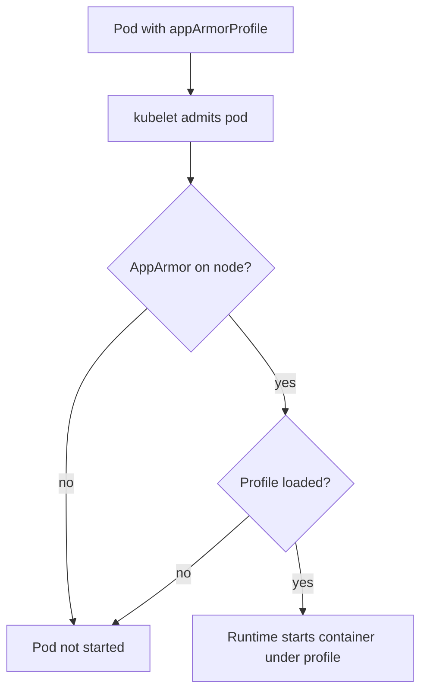

# Select A Profile With appArmorProfile

A loaded profile does nothing for a pod until the pod asks for it. In Kubernetes 1.35 the pod asks with the field `appArmorProfile` in a securityContext. This part shows the three types of the field, the difference between pod level and container level, what the kubelet checks when it admits the pod, and how to read the result from inside the container.

## The field and its types

The field `appArmorProfile` exists in the pod `securityContext`, where it applies to every container, and in the container `securityContext`, where it overrides the pod value. It has a required `type`:

- `RuntimeDefault` applies the default AppArmor profile of the container runtime. It is the right start for most workloads, the same way `RuntimeDefault` is for seccomp.
- `Localhost` applies a profile that is already loaded on the node. The field `localhostProfile` holds the profile name, the word after `profile` in the file.
- `Unconfined` applies no AppArmor profile. The process is limited only by normal permissions and other controls.

Older manifests use an annotation named `container.apparmor.security.beta.kubernetes.io/<container name>`. The annotation is deprecated. If a pod has both, the field wins, and new manifests should use only the field.

```yaml
securityContext:
  appArmorProfile:
    type: Localhost
    localhostProfile: k8s-deny-tmp-write
```

## What the kubelet checks

The kubelet is the component that decides whether the pod may start on its node. For a pod with an AppArmor profile it checks that the node supports AppArmor. For `Localhost` it also checks that the named profile is loaded in the kernel. If a check fails, the kubelet does not start the container, and the pod events say which check failed. On a node whose kernel has no AppArmor, a pod that asks for a profile cannot run there.

The container runtime then attaches the profile to the container process when it starts it. From that point the kernel enforces the profile, and the process cannot leave it. This is why a change of the profile for a running pod needs a new pod.



The diagram shows the two checks of the kubelet before the runtime attaches the profile.

## Use the profile in a pod

This section needs an active AppArmor module in the kernel. If your playground reports `N` or has no such file, read the section and use the result descriptions, because the pod would not start on your machine.

Select the environment:

<!-- astrona:playground:renew -->

```sh
export KUBECONFIG="$(astrona kubeconfig ats-033-playground-040-03)"
test "$(kubectl config current-context)" = "kind-astro-ats-033-playground-040-03" || exit 1
node_name="astro-ats-033-playground-040-03-control-plane"
run_on_node() { podman exec "$node_name" "$@"; }
run_on_node cat /sys/module/apparmor/parameters/enabled
```

If the answer is `Y`, save this profile as `k8s-deny-tmp-write` and load it on the node. It denies writes under `/tmp` and allows everything else:

```text
#include <tunables/global>

profile k8s-deny-tmp-write flags=(attach_disconnected) {
  #include <abstractions/base>

  file,
  network,
  capability,

  deny /tmp/** w,
}
```

```sh
podman cp k8s-deny-tmp-write "$node_name:/etc/apparmor.d/k8s-deny-tmp-write"
run_on_node apparmor_parser -r /etc/apparmor.d/k8s-deny-tmp-write
```

Save this as `pod-apparmor-container.yaml`. It sets `RuntimeDefault` at pod level for all containers and overrides it for one container with the custom profile:

```yaml
apiVersion: v1
kind: Pod
metadata:
  name: apparmor-two
  namespace: starfleet
spec:
  restartPolicy: Never
  securityContext:
    appArmorProfile:
      type: RuntimeDefault
  containers:
  - name: general
    image: docker.io/library/busybox:1.37.0
    command:
    - sh
    - -c
    - sleep 3600
  - name: guarded
    image: docker.io/library/busybox:1.37.0
    command:
    - sh
    - -c
    - sleep 3600
    securityContext:
      appArmorProfile:
        type: Localhost
        localhostProfile: k8s-deny-tmp-write
```

Apply it and wait for the pod:

```sh
kubectl apply -f pod-apparmor-container.yaml
kubectl -n starfleet wait --for=condition=Ready pod/apparmor-two --timeout=120s
```

Then read the profile that confines the main process of each container. The file `/proc/1/attr/current` contains the profile name and the mode in parentheses, or the word `unconfined`:

```sh
kubectl -n starfleet exec apparmor-two -c general -- cat /proc/1/attr/current
kubectl -n starfleet exec apparmor-two -c guarded -- cat /proc/1/attr/current
```

The first container reports the runtime default profile and the second reports `k8s-deny-tmp-write` in enforce mode. The container value replaced the pod value for `guarded` only. Now compare a write in the two containers. The second command is expected to fail, so run each on its own:

```sh
kubectl -n starfleet exec apparmor-two -c general -- sh -c 'echo test > /tmp/file'
kubectl -n starfleet exec apparmor-two -c guarded -- sh -c 'echo test > /tmp/file'
```

The first write succeeds and the second fails with `Permission denied`, although both containers run as root and `/tmp` is writable by file mode. The AppArmor profile, not the file permission, made the difference. Remove the pod:

```sh
kubectl -n starfleet delete pod apparmor-two
```

## When the profile is not available

If the profile is not loaded on the node, or AppArmor is missing, the pod does not start. Show it with the pod events:

```sh
kubectl -n starfleet describe pod apparmor-two
```

The `Events` section shows a warning from the kubelet. The repair is to load the profile on that node with `apparmor_parser -r`, or to schedule the pod on a node that has it. On a machine without AppArmor in the kernel, the repair is a different node or a different control, such as seccomp and dropped capabilities, and never `Unconfined` to hide the error.

You can now select an AppArmor profile at the right level and prove from inside the container which profile applies. AppArmor limits what the process touches. The next part limits what root power the process holds.

## Common pitfalls

> [!WARNING]
> - **Using the deprecated annotation.** New manifests use the `appArmorProfile` field.
> - **Mixing up the profile name and file name.** `localhostProfile` is the name written inside the profile file.
> - **Forgetting the container override.** A container value replaces the pod value, so check both levels.
> - **Switching to `Unconfined` when the pod will not start.** Load the profile on the node instead.
> - **Editing a running pod and expecting a change.** The profile is attached at container start. Create a new pod.
