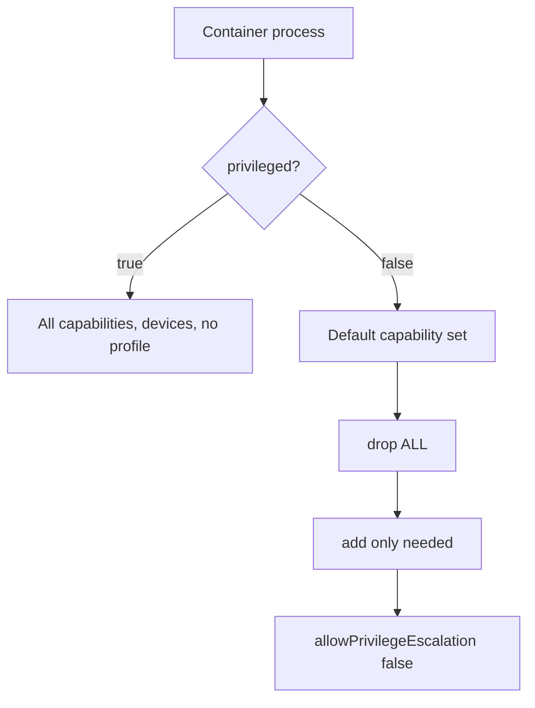

# Drop Capabilities And Block Privilege Escalation

A profile limits what a process can touch. A different question is how much power the process itself carries. In Linux, the power of root is divided into **capabilities**, small units such as changing file ownership or opening a raw network socket. A container that holds capabilities it never uses gives an attacker those powers for free. This part explains capabilities, `allowPrivilegeEscalation` and `privileged`, and shows how to read each of them in `/proc`.

## Capabilities

A capability is one unit of privileged operation. Examples are `CHOWN` (change file owners), `NET_BIND_SERVICE` (listen on a port below 1024), `NET_RAW` (use raw sockets) and `SYS_ADMIN` (a very broad set that includes mounting filesystems). A root process that holds a capability may do that operation. A process without it gets `Operation not permitted`, even as user ID 0.

The container runtime gives every container a default set of capabilities, which is smaller than full root but still includes powers such as `CHOWN`, `NET_RAW` and `SETUID`. The field `capabilities` in the container `securityContext` changes the set. `drop` removes capabilities from the default set, and `add` adds them. The word `ALL` in `drop` removes all of them. The accepted pattern is to drop `ALL` and add back only what the workload proves it needs.

The kernel keeps several sets for each process, and the file `/proc/1/status` shows them as hexadecimal masks:

- `CapBnd` is the bounding set, the upper limit of what the process and its children can ever hold.
- `CapEff` is the set the process uses right now.
- `CapPrm`, `CapInh` and `CapAmb` are the permitted, inheritable and ambient sets.

Each bit is one capability, and bit number 10 is `NET_BIND_SERVICE`, so a mask that holds only that capability reads `0000000000000400`. A mask of all zeros means none. A non-root process starts with an empty effective set unless an ambient capability is set, so for a workload that runs as a normal user, `CapBnd` is the reliable place to read what was dropped or added.

## allowPrivilegeEscalation and privileged

`allowPrivilegeEscalation: false` sets the kernel flag `no_new_privs` on the process. With the flag, a program started by the process cannot gain more rights than its parent had, for example through a setuid file or file capabilities. The line `NoNewPrivs: 1` in `/proc/1/status` shows it. Kubernetes allows escalation by default, so the field has to be set explicitly. A container that is `privileged` or that holds `CAP_SYS_ADMIN` always allows escalation.

`privileged: true` is a different thing. It gives the container all capabilities, access to the devices of the node and no default seccomp or AppArmor profile. A privileged container is close to a root process on the node itself, so it is almost never right for an application. `privileged: false` is the default, and the Pod Security Standards require it at both the `baseline` and the `restricted` level. Dropping capabilities in a container that is `privileged: true` has no meaningful effect, because the privileged flag overrides the restriction, so the first step in hardening such a workload is to remove `privileged`.



The diagram shows the order of hardening: remove `privileged`, shrink the capability set, then block escalation.

## Compare three containers

Select the environment:

<!-- astrona:playground:renew -->

```sh
export KUBECONFIG="$(astrona kubeconfig ats-033-playground-040-03)"
test "$(kubectl config current-context)" = "kind-astro-ats-033-playground-040-03" || exit 1
```

Save this as `pods-capability-compare.yaml`. The first pod uses the runtime defaults, the second drops everything and the third drops everything and adds one capability back:

```yaml
apiVersion: v1
kind: Pod
metadata:
  name: caps-default
  namespace: starfleet
spec:
  restartPolicy: Never
  containers:
  - name: shell
    image: docker.io/library/busybox:1.37.0
    command:
    - sh
    - -c
    - sleep 3600
---
apiVersion: v1
kind: Pod
metadata:
  name: caps-none
  namespace: starfleet
spec:
  restartPolicy: Never
  containers:
  - name: shell
    image: docker.io/library/busybox:1.37.0
    command:
    - sh
    - -c
    - sleep 3600
    securityContext:
      allowPrivilegeEscalation: false
      privileged: false
      capabilities:
        drop:
        - ALL
---
apiVersion: v1
kind: Pod
metadata:
  name: caps-bind
  namespace: starfleet
spec:
  restartPolicy: Never
  containers:
  - name: shell
    image: docker.io/library/busybox:1.37.0
    command:
    - sh
    - -c
    - sleep 3600
    securityContext:
      allowPrivilegeEscalation: false
      privileged: false
      capabilities:
        drop:
        - ALL
        add:
        - NET_BIND_SERVICE
```

Apply it and wait for the pods:

```sh
kubectl apply -f pods-capability-compare.yaml
kubectl -n starfleet wait --for=condition=Ready pod/caps-default pod/caps-none pod/caps-bind --timeout=120s
```

Then print the capability and privilege lines of each pod:

```sh
for pod_name in caps-default caps-none caps-bind; do
  printf '%s\n' "$pod_name"
  kubectl -n starfleet exec "$pod_name" -- grep -E 'CapBnd|CapEff|NoNewPrivs' /proc/1/status
done
```

The pod `caps-default` shows a non-zero set and `NoNewPrivs: 0`, because the runtime default capabilities remain and escalation is allowed. The pod `caps-none` shows `CapBnd` and `CapEff` made of zeros and `NoNewPrivs: 1`. The pod `caps-bind` shows `0000000000000400` in both sets, which is the single bit for `NET_BIND_SERVICE`, and `NoNewPrivs: 1`. Each added capability appears as one more bit, so the masks let you check a manifest against the running process.

Next, see what a dropped capability costs. The command below tries to change the owner of a file. In the pod with no capabilities, the root user no longer holds `CHOWN`, so it is expected to fail. Run it on its own:

```sh
kubectl -n starfleet exec caps-none -- sh -c 'touch /tmp/f && chown 1000 /tmp/f'
```

The command fails with `Operation not permitted`. The same command in `caps-default` succeeds, because `CHOWN` is part of the default set. This shows that the user is root in both pods, and the capability set made the difference. Remove the pods:

```sh
kubectl -n starfleet delete pod caps-default caps-none caps-bind
```

You can now read and set the three privilege controls and prove them from the running process. A hardened workload combines them with a seccomp filter and, where the node allows it, an AppArmor profile, so that each boundary covers what the others cannot.

## Common pitfalls

> [!WARNING]
> - **Dropping capabilities and leaving `privileged: true`.** The privileged flag gives all capabilities back. Set `privileged: false`.
> - **Leaving `allowPrivilegeEscalation` unset.** It defaults to allowed. Set it to `false` explicitly.
> - **Adding back `SYS_ADMIN` to fix an error.** It is a broad capability. Find the single capability that the failing operation needs.
> - **Reading `CapEff` for a non-root process.** It is empty even when capabilities were added. Read `CapBnd` instead.
> - **Putting `capabilities` at pod level.** The field exists only in the container `securityContext`.
