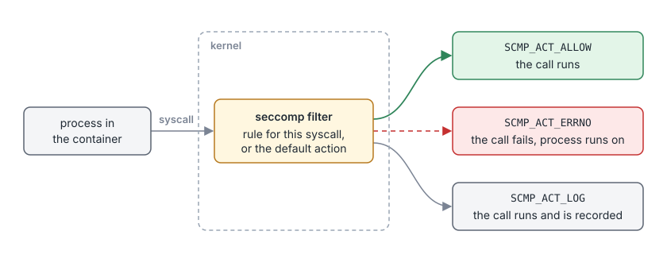
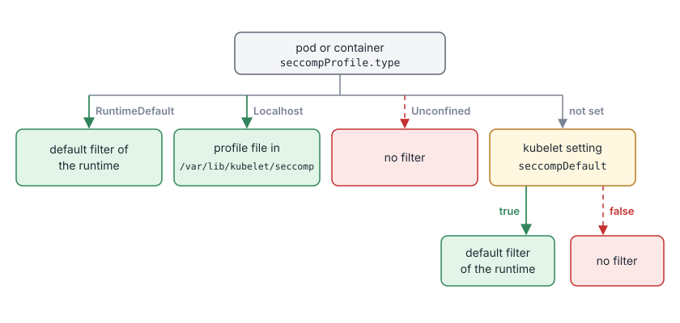
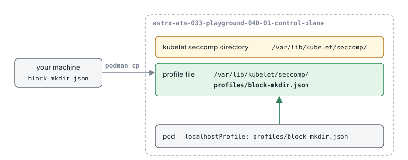

# Seccomp: Filtering System Calls

A program cannot touch hardware, files or the network on its own. It asks the kernel to do the work by making a **system call** (syscall). For example, `openat` opens a file, `read` reads it and `mount` attaches a filesystem.

The kernel offers several hundred syscalls, but a typical application uses only a few dozen. The rest are unused attack surface. A kernel flaw in a rarely used syscall can be reached by any process that is allowed to call it.

**seccomp** (secure computing mode) is a kernel feature that closes this gap. It lets a process install a filter. The kernel then checks every syscall of that process against the filter, and it allows the call, rejects it with an error, or kills the process. On this page, you see how a filter behaves, how Kubernetes chooses one, and how to check and load a profile on a real node.

## How a filter behaves

A seccomp filter belongs to a process, and every child process inherits it. A process can add filters, but it can never remove them. So a container runtime can install a filter before it starts the application and be sure that the application cannot lift it.

A seccomp **profile** is the list of rules that the filter uses. Each rule names one or more syscalls and an action. A default action covers every syscall that no rule mentions. These are the actions you will meet:

- `SCMP_ACT_ALLOW`: the syscall runs as normal.
- `SCMP_ACT_ERRNO`: the syscall fails with an error code, and the process keeps running.
- `SCMP_ACT_LOG`: the syscall is allowed, and the kernel records it.



The drawing shows the kernel checking each syscall against the filter and applying the action of the matching rule, or the default action when no rule matches.

A seccomp filter does not look at which file or which address a call uses. It decides only on the syscall and its numeric arguments. Decisions that depend on file paths belong to AppArmor, a different kernel feature.

## The three profile types in Kubernetes

Kubernetes selects a seccomp profile with the field `seccompProfile` in a securityContext. The securityContext is the part of the pod or container specification that holds its security settings. The field exists at pod level and at container level, and the container value overrides the pod value. It takes one of three types:

- `RuntimeDefault` uses the default profile of the container runtime. It blocks a set of dangerous or rarely needed syscalls and allows the ones normal applications use. It is the right starting point for almost every workload.
- `Localhost` uses a profile file that exists on the node. The field `localhostProfile` holds the path relative to the kubelet's seccomp directory, which is `/var/lib/kubelet/seccomp` by default. The file must exist on every node where the pod can run.
- `Unconfined` installs no filter. The process may call every syscall that the kernel offers. A privileged container also runs without a filter.

What happens when a pod sets no `seccompProfile` at all? Then the pod runs as `Unconfined`, unless the kubelet runs with the setting `seccompDefault: true`. With that setting, the kubelet applies `RuntimeDefault` to every pod that does not choose a profile.

The Pod Security Standards also care about this field. They are the built-in Kubernetes security levels for pods. The `baseline` level rejects an explicit `Unconfined` profile, and the `restricted` level requires `RuntimeDefault` or `Localhost`.



The drawing shows how the kubelet resolves the profile: an explicit type wins, and an unset field falls back to the kubelet setting `seccompDefault`.

## Read the seccomp state of a process

You can see the result of these rules inside a running container. Every process has a status file under `/proc`, and two of its lines matter here:

- `Seccomp:` shows the mode. `0` means no filter, `1` means the old strict mode, and `2` means a filter is installed.
- `NoNewPrivs:` shows `1` when the process, and everything it starts, can never gain privileges through setuid programs. The setting `allowPrivilegeEscalation: false` turns it on.

Select the environment first, and then start two pods that differ only in their profile:

<!-- astrona:playground:renew -->

```sh
export KUBECONFIG="$(astrona kubeconfig ats-033-playground-040-01)"
test "$(kubectl config current-context)" = "kind-astro-ats-033-playground-040-01" || exit 1
```

Save this as `pods-seccomp-compare.yaml`:

```yaml
apiVersion: v1
kind: Pod
metadata:
  name: seccomp-default
  namespace: starfleet
spec:
  restartPolicy: Never
  securityContext:
    seccompProfile:
      type: RuntimeDefault
  containers:
  - name: shell
    image: docker.io/library/busybox:1.37.0
    command:
    - sh
    - -c
    - sleep 3600
---
apiVersion: v1
kind: Pod
metadata:
  name: seccomp-unconfined
  namespace: starfleet
spec:
  restartPolicy: Never
  securityContext:
    seccompProfile:
      type: Unconfined
  containers:
  - name: shell
    image: docker.io/library/busybox:1.37.0
    command:
    - sh
    - -c
    - sleep 3600
```

Apply it and wait for both pods:

```sh
kubectl apply -f pods-seccomp-compare.yaml
kubectl -n starfleet wait --for=condition=Ready pod/seccomp-default pod/seccomp-unconfined --timeout=120s
```

Then compare the process state in both pods:

```sh
kubectl -n starfleet exec seccomp-default -- grep -E 'Seccomp|NoNewPrivs' /proc/1/status
kubectl -n starfleet exec seccomp-unconfined -- grep -E 'Seccomp|NoNewPrivs' /proc/1/status
```

The first pod reports `Seccomp: 2`, because the runtime installed its default filter. The second pod reports `Seccomp: 0`, so its process can call every syscall. `NoNewPrivs` is `0` in both pods, because neither pod disables privilege escalation yet.

Remove the pods when you are done:

```sh
kubectl -n starfleet delete pod seccomp-default seccomp-unconfined
```

## A custom profile with Localhost

The default profile is a compromise that suits most applications. A workload with a narrow job can use a stricter profile. A seccomp profile for `Localhost` is a JSON file on the node.

The profile below allows everything except the syscalls that create a directory, so the test result is easy to read. A real profile does the opposite: it denies by default and lists the syscalls it allows.

Save this as `block-mkdir.json`:

```json
{
  "defaultAction": "SCMP_ACT_ALLOW",
  "syscalls": [
    {
      "names": ["mkdir", "mkdirat"],
      "action": "SCMP_ACT_ERRNO"
    }
  ]
}
```

Now copy the file into the seccomp directory of the node. `podman cp` copies a file into a container, and the target directory must exist first. The playground has one node, so one copy is enough. In a cluster with several nodes, you repeat these commands on each node where the pod can run:

```sh
node_name="astro-ats-033-playground-040-01-control-plane"
podman exec "$node_name" mkdir -p /var/lib/kubelet/seccomp/profiles
podman cp block-mkdir.json "$node_name:/var/lib/kubelet/seccomp/profiles/block-mkdir.json"
```



The drawing shows where the file lands on the node, and why `localhostProfile` holds only the part of the path after `/var/lib/kubelet/seccomp/`.

Save this as `pod-seccomp-localhost.yaml`:

```yaml
apiVersion: v1
kind: Pod
metadata:
  name: seccomp-localhost
  namespace: starfleet
spec:
  restartPolicy: Never
  securityContext:
    seccompProfile:
      type: Localhost
      localhostProfile: profiles/block-mkdir.json
  containers:
  - name: shell
    image: docker.io/library/busybox:1.37.0
    command:
    - sh
    - -c
    - sleep 3600
```

Apply it and wait for the pod:

```sh
kubectl apply -f pod-seccomp-localhost.yaml
kubectl -n starfleet wait --for=condition=Ready pod/seccomp-localhost --timeout=120s
```

Then check the result. Run the directory creation as a separate command, because it is expected to fail:

```sh
kubectl -n starfleet exec seccomp-localhost -- grep Seccomp /proc/1/status
kubectl -n starfleet exec seccomp-localhost -- mkdir /tmp/newdir
```

The first command reports `Seccomp: 2`. The `mkdir` command is expected to fail with an `Operation not permitted` error. The filter returns an error for the directory syscalls, even though the user is allowed to write in `/tmp`.

The pod keeps running. This shows the difference between `SCMP_ACT_ERRNO` and a profile that kills the process. Remove the pod when you are done:

```sh
kubectl -n starfleet delete pod seccomp-localhost
```

You can now read and choose the seccomp profile of a workload, and load a custom profile on a node. But a syscall filter cannot say which file a process may open. So the open question is how to restrict a process by the names of the files and resources it uses.

## Common pitfalls

> [!WARNING]
> - **Assuming containers have a filter by default.** Without `seccompProfile` or the kubelet setting `seccompDefault: true`, a pod runs without a filter.
> - **Writing the profile path in the wrong form.** `localhostProfile` is relative to the kubelet seccomp directory. Do not write the full path.
> - **Copying a profile to one node only.** A pod that uses `Localhost` fails on every node that does not have the file.
> - **Treating `Unconfined` as harmless.** It turns off the filter. Use it only where an owner has a documented reason.
