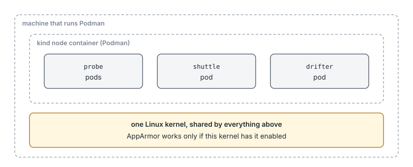
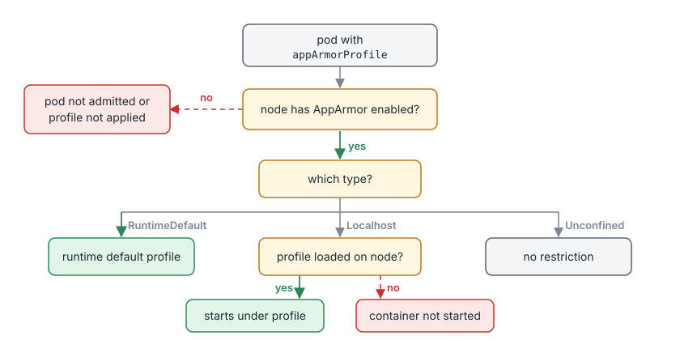
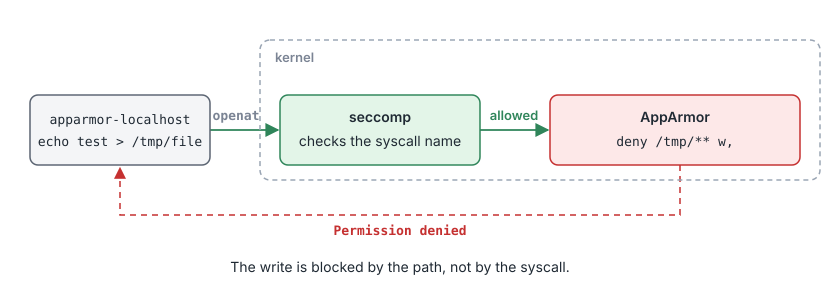

# AppArmor: Profiles For Files And Capabilities

Seccomp decides which system calls (syscalls) a process may make. But it cannot say which file the process may open, because seccomp does not inspect the path in the call. So a process under a seccomp filter can still open any file that the filter and the file permissions allow.

**AppArmor** fills this gap. AppArmor is a Linux security module, which is a kernel component that adds access rules on top of the normal file permissions. It attaches a **profile** to a program. The profile lists the files and directories the program may read, write or execute, the Linux capabilities it may use, and the network operations it may perform.

Everything the profile does not allow is denied, even when the user is root and the file permissions would allow it. This type of control is called **mandatory access control**, because the process cannot change it. On this page, you see the profile modes, what a node must provide, the Kubernetes field, and a profile that blocks writes in a real pod.

## Profile modes and the tools

A profile runs in one of two modes:

- In **enforce** mode, the kernel blocks the violations and logs them.
- In **complain** mode, the kernel allows and logs an access that no rule of the profile covers. This is useful while you write a profile and learn what the program needs. An explicit `deny` rule still blocks in complain mode.

Profiles are text files, normally under `/etc/apparmor.d` on the node. A profile file has no effect until it is loaded into the kernel. You meet these tools and files on the node:

- `apparmor_parser -r <file>` loads a profile into the kernel, or replaces a profile that is already loaded.
- `aa-status` lists the loaded profiles, their modes and the processes that run under them.
- `/sys/module/apparmor/parameters/enabled` contains `Y` when the AppArmor module is active in the kernel.

## What the node must provide

A pod can use AppArmor only when the node that runs it provides these things:

- The kernel of the node has AppArmor enabled.
- The container runtime supports AppArmor. The runtime also needs AppArmor for `RuntimeDefault`, because it loads its own default profile.
- For a `Localhost` profile, the profile is loaded into the kernel of that node.

Ubuntu and Debian kernels have AppArmor enabled by default. Distributions such as Fedora use SELinux, another Linux security module, instead.

The playground needs one more thought. A `kind` node is a container, and it uses the kernel of the machine that runs Podman. If that kernel has no AppArmor, no pod in the playground can use it, whatever the manifest says. You check this with a single command further down this page.



The drawing shows that the pods and the `kind` node container have no kernel of their own: they all use the kernel of the machine that runs Podman.

## The Kubernetes field

Since Kubernetes v1.30, you select the profile with the field `appArmorProfile` inside a securityContext, at pod level or at container level. The container value overrides the pod value. The older way was an annotation named `container.apparmor.security.beta.kubernetes.io/<container name>`. It is deprecated and should not appear in new manifests.

The field has three types, with the same meaning as for seccomp:

- `RuntimeDefault` applies the default profile of the container runtime.
- `Localhost` applies a profile that is already loaded on the node. The field `localhostProfile` holds the profile name. This is the name inside the profile file, not the file name.
- `Unconfined` applies no AppArmor restriction.

```yaml
securityContext:
  appArmorProfile:
    type: Localhost
    localhostProfile: k8s-deny-write
```

Two components check the profile before the container starts. The kubelet checks that AppArmor is enabled on the node when it admits the pod. If a `Localhost` profile is not loaded on the node, the container runtime (containerd) refuses to create the container, and the pod shows `CreateContainerError`.



The drawing shows where a pod stops. The node must support AppArmor, and a `Localhost` profile must be loaded before the container can start.

## Check AppArmor on the node

Before you write a profile, check whether the playground can use one. Select the environment and define the helper `run_on_node`, which runs a command inside the node container:

<!-- astrona:playground:renew -->

```sh
export KUBECONFIG="$(astrona kubeconfig ats-033-playground-040-01)"
test "$(kubectl config current-context)" = "kind-astro-ats-033-playground-040-01" || exit 1
node_name="astro-ats-033-playground-040-01-control-plane"
run_on_node() { podman exec "$node_name" "$@"; }
```

Ask the kernel whether AppArmor is active:

```sh
run_on_node cat /sys/module/apparmor/parameters/enabled
```

The answer `Y` means the module is active. If the file does not exist or contains `N`, AppArmor is not available in this playground, and the rest of this page is reading material. That is a normal result on a machine whose kernel uses another security module. It does not mean that the playground is broken.

The graded task on the next page runs in a virtual machine whose kernel has AppArmor enabled, so you can practise these steps there. If AppArmor is active, list the loaded profiles with `aa-status`. The tool may be missing inside the node image, and the output of the next command then tells you so:

```sh
run_on_node aa-status
```

## Write, load and use a profile

The next profile denies all writes to files under `/tmp` and allows everything else. It is small on purpose, so the effect is easy to see. Save it as `k8s-deny-tmp-write`:

```text
#include <tunables/global>

profile k8s-deny-tmp-write flags=(attach_disconnected) {
  #include <abstractions/base>

  file,
  network,
  capability,
  signal (receive) peer=runc,

  deny /tmp/** w,
}
```

Each line of the profile has one job:

- `deny /tmp/** w,` forbids write access to every path under `/tmp`.
- `file`, `network` and `capability` allow all other file, network and capability use.
- `signal (receive) peer=runc,` lets the container runtime (`runc`) send the stop signal to the container. Without it, a deleted pod stays in `Terminating` on an Ubuntu node.

Now load the profile on the node. This works only when the check above printed `Y` and the node image has `apparmor_parser`:

```sh
podman cp k8s-deny-tmp-write "$node_name:/etc/apparmor.d/k8s-deny-tmp-write"
run_on_node apparmor_parser -r /etc/apparmor.d/k8s-deny-tmp-write
```

Save this as `pod-apparmor-localhost.yaml`:

```yaml
apiVersion: v1
kind: Pod
metadata:
  name: apparmor-localhost
  namespace: starfleet
spec:
  restartPolicy: Never
  containers:
  - name: shell
    image: docker.io/library/busybox:1.37.0
    command:
    - sh
    - -c
    - sleep 3600
    securityContext:
      appArmorProfile:
        type: Localhost
        localhostProfile: k8s-deny-tmp-write
```

Apply it and wait for the pod:

```sh
kubectl apply -f pod-apparmor-localhost.yaml
kubectl -n starfleet wait --for=condition=Ready pod/apparmor-localhost --timeout=120s
```

Then check the result. The first command shows the profile that confines the main process. The second command is expected to fail, so run it on its own:

```sh
kubectl -n starfleet exec apparmor-localhost -- cat /proc/1/attr/current
kubectl -n starfleet exec apparmor-localhost -- sh -c 'echo test > /tmp/file'
```

The first command prints the profile name `k8s-deny-tmp-write`, followed by the mode in parentheses.

In a kind cluster, the line can also carry a suffix after the name. A kind node is itself a container, and the kernel stacks the pod's profile on top of the confinement of that node container. Stacking means that the kernel applies both labels at once and allows an action only when both allow it.

For example, one run on a kind cluster printed `k8s-deny-tmp-write//&unconfined (enforce)`. The part before `//&` is the pod's profile. `enforce` is the mode: AppArmor blocks and logs what the profile denies.

The write is expected to fail with a `Permission denied` error. Yet `/tmp` is writable for the user, and seccomp would have allowed the `openat` syscall. This is the difference between the two boundaries.



The drawing shows that seccomp decides on the syscall name, while AppArmor decides on the path, so only AppArmor can block this write. Remove the pod with `kubectl -n starfleet delete pod apparmor-localhost` when you are done.

If AppArmor is not active in your playground, the pod does not start. You learn to read that symptom later in this module.

You now know what an AppArmor profile restricts, how the node loads it, and how a pod refers to it by name. The open question is how to combine both kernel profiles with the other container settings into one workload that gives up every right it does not need.

## Common pitfalls

> [!WARNING]
> - **Using the file name as the profile name.** `localhostProfile` takes the name written after the keyword `profile` inside the file.
> - **Loading the profile on one node only.** The profile must be loaded on every node where the pod can be scheduled. A node restart removes loaded profiles, unless a service loads them at boot.
> - **Assuming AppArmor exists everywhere.** A node with another security module, such as SELinux, cannot enforce an AppArmor profile.
> - **Writing a profile in enforce mode first.** Start in complain mode, read the log, and switch to enforce mode when the profile covers what the program does.
> - **Using the deprecated annotation.** Use the `appArmorProfile` field in new manifests.
