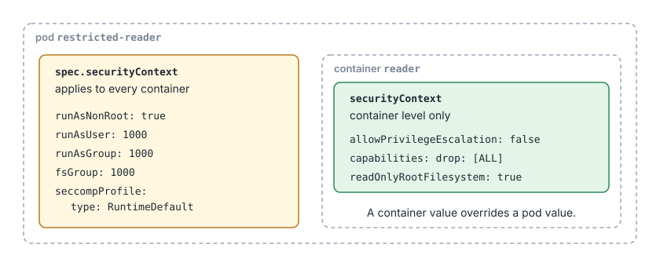
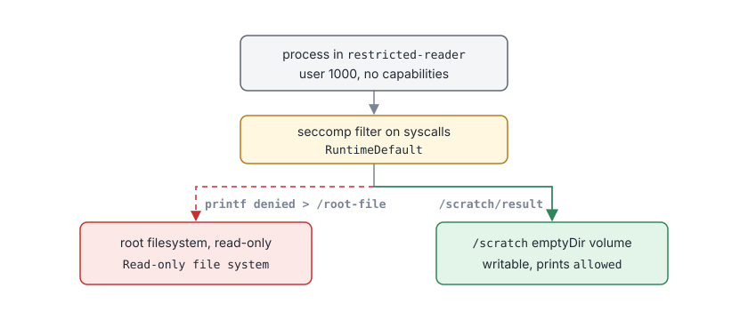

# The Restricted Security Context

Seccomp and AppArmor are two of several settings that reduce what a container can do. A container that has a seccomp filter but runs as root, with all its capabilities and a writable root filesystem, still gives an attacker a lot of room. The other settings close that room.

The Pod Security Standard named `restricted` collects these settings into one set of rules. The Pod Security Standards are the built-in Kubernetes security levels for pods, and `restricted` is the strictest of them. The container fields behind it fit in a short manifest.

On this page, you build that manifest for a small workload. The workload runs as a normal user, keeps its root filesystem read-only and writes only to a scratch volume. Then you prove each setting from inside the container.

## The settings and what each one stops

Each field in the securityContext removes one right from the container process. The securityContext is the part of the pod or container specification that holds these security settings:

- `runAsNonRoot: true` makes the kubelet refuse a container whose image would start as user ID 0. `runAsUser` and `runAsGroup` set the numeric IDs. A process that is not root has no write access to most of the filesystem and cannot use root-only operations.
- `allowPrivilegeEscalation: false` sets the `no_new_privs` flag. A setuid program then cannot gain more rights than its parent had.
- `capabilities.drop: ["ALL"]` removes every Linux capability. Capabilities are the units into which the power of root is split. Add back only what a workload provably needs.
- `readOnlyRootFilesystem: true` mounts the root filesystem of the container read-only. An attacker cannot place a binary or edit a configuration file there. The application writes to a mounted volume, such as an `emptyDir`, instead.
- `seccompProfile` selects the seccomp filter on syscalls, and `appArmorProfile` selects the AppArmor profile that restricts files, capabilities and network operations.
- `fsGroup` sets a group ID that owns the files of supported volumes, and it is added to the groups of every container process. It matters for a volume whose files already have an owner, such as a persistent volume. It is a pod-level field.

Settings at pod level apply to every container. A value at container level overrides the pod value. Some fields, such as `allowPrivilegeEscalation`, `capabilities` and `readOnlyRootFilesystem`, exist at container level only.



The drawing shows which fields of the manifest below sit at pod level and which sit at container level, and that a container value wins over a pod value.

## Build the manifest

Now put these fields into one pod. Select the environment:

<!-- astrona:playground:renew -->

```sh
export KUBECONFIG="$(astrona kubeconfig ats-033-playground-040-01)"
test "$(kubectl config current-context)" = "kind-astro-ats-033-playground-040-01" || exit 1
```

Save this as `pod-restricted-reader.yaml`:

```yaml
apiVersion: v1
kind: Pod
metadata:
  name: restricted-reader
  namespace: starfleet
spec:
  restartPolicy: Never
  containers:
  - name: reader
    image: docker.io/library/busybox:1.37.0
    command:
    - sh
    - -c
    - sleep 3600
    securityContext:
      allowPrivilegeEscalation: false
      capabilities:
        drop:
        - ALL
      readOnlyRootFilesystem: true
    volumeMounts:
    - name: scratch
      mountPath: /scratch
  securityContext:
    runAsNonRoot: true
    runAsUser: 1000
    runAsGroup: 1000
    fsGroup: 1000
    seccompProfile:
      type: RuntimeDefault
  volumes:
  - name: scratch
    emptyDir: {}
```

The manifest has no `appArmorProfile`, because AppArmor needs a node whose kernel supports it. On a node that supports it, add `appArmorProfile: {type: RuntimeDefault}` next to the seccomp profile at pod level.

Apply it:

```sh
kubectl apply -f pod-restricted-reader.yaml
```

## Prove each setting

A manifest only states what you want. The proof is what the process inside the container can and cannot do. Wait for the pod, then check the result from inside the container:

```sh
kubectl -n starfleet wait --for=condition=Ready pod/restricted-reader --timeout=180s
kubectl -n starfleet exec restricted-reader -- id -u
kubectl -n starfleet exec restricted-reader -- sh -c 'printf allowed > /scratch/result; cat /scratch/result'
kubectl -n starfleet exec restricted-reader -- grep -E 'Seccomp|NoNewPrivs|CapEff' /proc/1/status
```

The user ID is `1000`. The scratch write succeeds and prints `allowed`, because the kubelet creates a new `emptyDir` that is writable for every user. The status lines show three more results:

- `Seccomp: 2` shows the installed filter.
- `NoNewPrivs: 1` shows that privilege escalation is disabled.
- The effective capability set `CapEff` is made of zeros, which means no capabilities are left.

The negative check comes last. It is expected to fail, so run it on its own:

```sh
kubectl -n starfleet exec restricted-reader -- sh -c 'printf denied > /root-file'
```

The command fails with an error that says the filesystem is read-only. A read-only root filesystem and a writable volume exist side by side, because the volume is a separate mount. This pair is the usual way to keep an application running while its image stays unchangeable.



The drawing shows the layers from the process outwards: a weak identity, a filtered set of syscalls, and a filesystem where only one path accepts writes.

## Enforce it for a whole namespace

A manifest that sets these fields protects only the workloads that use it. Pod Security Admission is the built-in admission controller that applies a Pod Security Standard to a whole namespace. Its namespace labels choose a level and a mode:

- `enforce` rejects pods that violate the level.
- `audit` records violations in the audit log.
- `warn` shows a warning to the client.

To see which existing pods would violate the `restricted` level without blocking any of them, run a server-side dry run of the label:

```sh
kubectl label --dry-run=server --overwrite namespace starfleet pod-security.kubernetes.io/enforce=restricted
```

The API server prints warnings. Each warning names a pod in `starfleet` that would violate the level, and the fields that cause it. The `probe` Deployment has no securityContext, so it is expected to appear there.

Reading these warnings is the step before you set an `enforce` label. The label does not remove running pods, but it blocks their next restart.

You can now write and verify the container settings that make up the restricted standard, and test a namespace against it before you enforce it. The open question is what happens when one of the kernel profiles in the manifest is missing or wrong, and how you find the cause.

## Common pitfalls

> [!WARNING]
> - **Running as non-root and stopping there.** A non-root user with all capabilities and with escalation allowed does not meet the restricted standard. Combine all the settings.
> - **Making the root filesystem read-only without a writable volume.** Applications that write temporary files crash. Mount an `emptyDir` for each path that needs writes.
> - **Expecting `fsGroup` to fix every write error.** A new `emptyDir` is already writable for every user. `fsGroup` helps with a volume whose files belong to another user, and it cannot make a read-only root filesystem writable.
> - **Putting container-only fields at pod level.** `allowPrivilegeEscalation`, `capabilities` and `readOnlyRootFilesystem` belong under `containers[].securityContext`.
> - **Applying an `enforce` label without a dry run.** Existing workloads fail to restart when they violate the level.
