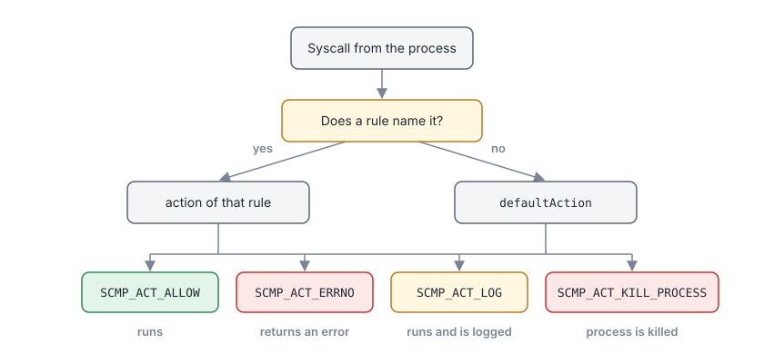
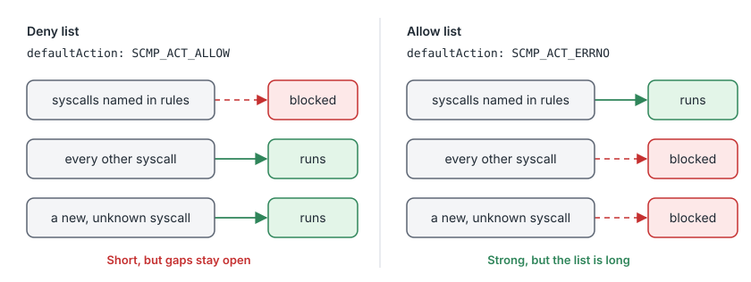
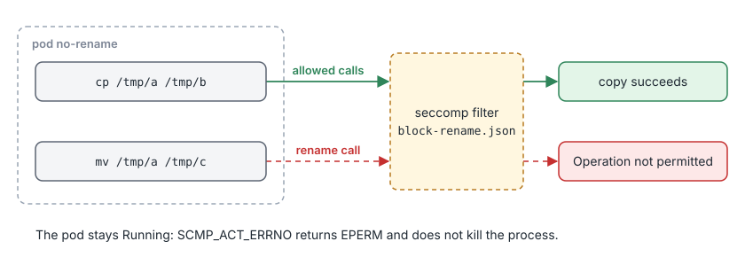

# Write And Load A Localhost Profile

The default profile of the runtime fits most workloads, but it cannot know what your application must never do. A workload that only reads and serves files has no need to rename files, load kernel modules or trace other processes. A `Localhost` profile lets you state those limits yourself.

On this page, you learn the JSON structure of a profile and the two ways to write one. Then you load a profile on a node and run a pod under it.

## The structure of a profile

A seccomp profile is a JSON document in the format of the OCI (Open Container Initiative) runtime specification. These fields matter for Kubernetes:

- `defaultAction` is the action for every syscall that no rule names. It is required.
- `architectures` lists the processor architectures to which the rules apply, for example `SCMP_ARCH_X86_64` and `SCMP_ARCH_AARCH64`. If it is missing, the rules apply to the native architecture of the node.
- `syscalls` is a list of rules. Each rule has `names`, a list of syscall names, and an `action`. A rule can also have `args`, which compares the numeric arguments of the call, and `errnoRet`, the error number that an `SCMP_ACT_ERRNO` rule returns.

Each rule ends in an action. The actions that you meet most often are these:

| Action | Effect on the syscall |
| --- | --- |
| `SCMP_ACT_ALLOW` | The syscall runs normally. |
| `SCMP_ACT_ERRNO` | The syscall does not run and returns an error. The process continues. |
| `SCMP_ACT_LOG` | The syscall runs and the kernel logs it. |
| `SCMP_ACT_KILL_PROCESS` | The kernel ends the whole process. |

`SCMP_ACT_ERRNO` returns `EPERM` (error number 1, shown as `Operation not permitted`) unless `errnoRet` says otherwise. It is the usual choice. An application can handle an error, while a killed process is hard to debug.

The kernel checks each syscall against the rules in a simple way. If a rule names the syscall, the action of that rule decides. If no rule names it, `defaultAction` decides.



The drawing shows the check: a matching rule decides, and `defaultAction` decides every other syscall.

## Allow list or deny list

Because `defaultAction` decides everything that no rule names, it also sets the style of the whole profile. The two ways to write a profile differ in the `defaultAction`.

A **deny list** uses `defaultAction: SCMP_ACT_ALLOW` and names the syscalls to block. It is short and easy to read, and it keeps the application working. But a syscall that you did not think of stays open. A deny list reduces risk for the calls it names and does nothing for the rest.

An **allow list** uses `defaultAction: SCMP_ACT_ERRNO` and names the syscalls that the application needs. Everything new is blocked, which is the strongest form, but the list is long. Even a small program needs dozens of syscalls to start, because the runtime itself needs some of them to set up the process.

An allow list that misses one syscall makes the container fail at start, or later at a rare code path. For this reason, people build an allow list from a record of what the application did. Another way is to start from the runtime default profile and remove entries.



The drawing compares the two styles. The difference shows in the syscall that nobody thought of: a deny list lets it run, and an allow list blocks it.

## Write a deny-list profile

A deny list is the easier style to start with, so the first profile uses it. The profile below blocks the syscalls that rename or move a file, and it allows everything else.

Several names are listed because kernels and architectures provide different calls for the same job. `rename` exists only on older architectures, `renameat` is the common form, and `renameat2` is the newer form with flags. Naming all three means the block does not depend on which one the program uses.

Save this as `block-rename.json`:

```json
{
  "defaultAction": "SCMP_ACT_ALLOW",
  "syscalls": [
    {
      "names": ["rename", "renameat", "renameat2"],
      "action": "SCMP_ACT_ERRNO",
      "errnoRet": 1
    }
  ]
}
```

Check that the profile is valid JSON before you copy it. A profile with a JSON syntax error makes the container fail to start, and a check on your machine is faster than reading a pod event:

```sh
python3 -m json.tool block-rename.json
```

## Place the profile on the node

The file is ready on your machine, but the kubelet reads it only from the node. Select the environment and name the node. The node is a Podman container, so `podman exec` runs a command inside it, and `podman cp` copies a file into it.

<!-- astrona:playground:renew -->

```sh
export KUBECONFIG="$(astrona kubeconfig ats-033-playground-040-02)"
test "$(kubectl config current-context)" = "kind-astro-ats-033-playground-040-02" || exit 1
node_name="astro-ats-033-playground-040-02-control-plane"
```

Create the directory and copy the profile into it. The playground has one node. In a real cluster, you repeat these steps on every node that can run the pod, usually with configuration management or with a DaemonSet that copies the file:

```sh
podman exec "$node_name" mkdir -p /var/lib/kubelet/seccomp/profiles
podman cp block-rename.json "$node_name:/var/lib/kubelet/seccomp/profiles/block-rename.json"
podman exec "$node_name" ls -l /var/lib/kubelet/seccomp/profiles
```

The listing shows the file `block-rename.json`. The name in the pod specification will be `profiles/block-rename.json`, which is the part of the path after the kubelet seccomp directory.

## Run a pod under the profile

With the file on the node, a pod can ask for it by name. Save this as `pod-seccomp-block-rename.yaml`:

```yaml
apiVersion: v1
kind: Pod
metadata:
  name: no-rename
  namespace: starfleet
spec:
  restartPolicy: Never
  securityContext:
    seccompProfile:
      type: Localhost
      localhostProfile: profiles/block-rename.json
  containers:
  - name: shell
    image: docker.io/library/busybox:1.37.0
    command:
    - sh
    - -c
    - sleep 3600
```

Apply it and wait for the pod:

```sh
kubectl apply -f pod-seccomp-block-rename.yaml
kubectl -n starfleet wait --for=condition=Ready pod/no-rename --timeout=120s
```

The kubelet read the file when it created the container, and `runc` loaded it as a filter. Prove it from inside the container. Start with an operation that the profile allows, which is creating and copying a file:

```sh
kubectl -n starfleet exec no-rename -- grep Seccomp: /proc/1/status
kubectl -n starfleet exec no-rename -- sh -c 'echo data > /tmp/a && cp /tmp/a /tmp/b && cat /tmp/b'
```

The status shows `Seccomp: 2`, and the copy succeeds. Creating, reading and writing a file are not in the rule.

Now try the operation that the profile blocks. The command is expected to fail, so run it on its own:

```sh
kubectl -n starfleet exec no-rename -- mv /tmp/a /tmp/c
```

The command fails with `Operation not permitted`, although the user is root and owns both files. File mode and ownership are not the cause: the kernel returned `EPERM` before it looked at them. The pod stays in the `Running` state, which confirms that the action was `SCMP_ACT_ERRNO` and not a kill.



The drawing shows the two commands side by side. The kernel lets the copy through and answers the rename with an error, and the process keeps running.

Remove the pod when you are done:

```sh
kubectl -n starfleet delete pod no-rename
```

You can now write a deny-list profile, place it on a node and check that it changes the behaviour of a running process. A profile that works on the first try is the exception, though. The open question is how to find which syscall a profile blocks, and how to repair a pod that fails.

## Common pitfalls

> [!WARNING]
> - **Writing invalid JSON.** A trailing comma or a missing bracket makes the container fail to start. Check the file with a JSON tool first.
> - **Naming only one variant of a syscall.** Programs may use `rename`, `renameat` or `renameat2`. List every variant that the block must cover.
> - **Using `defaultAction: SCMP_ACT_ERRNO` without a full allow list.** The runtime and the application need many syscalls to start, so the container then fails.
> - **Copying the file to one node only.** The pod fails on every node that does not have the file at the same relative path.
> - **Putting the whole path in `localhostProfile`.** Use `profiles/block-rename.json`, not `/var/lib/kubelet/seccomp/profiles/block-rename.json`.
