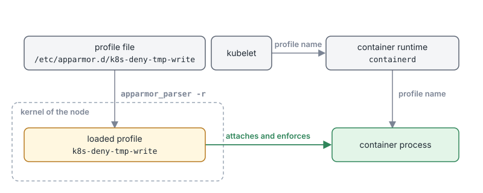
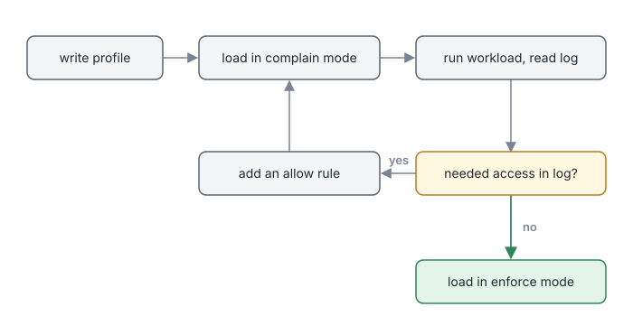
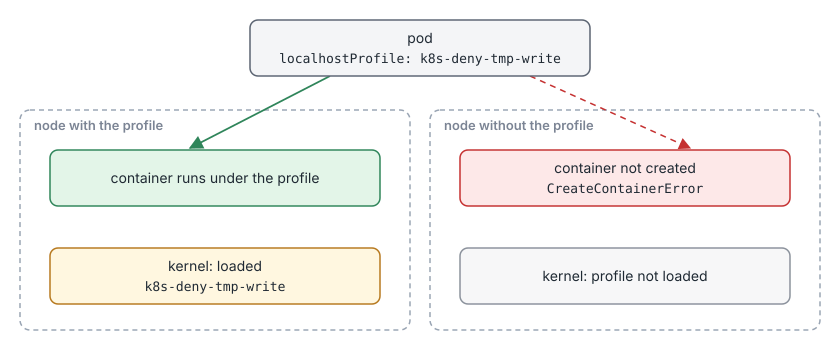

# AppArmor Modes And Loading Profiles

Seccomp (secure computing mode) decides which system calls a process may make. A system call is a request from a program to the kernel, such as `openat` to open a file. But seccomp cannot decide which file the call opens. A process that may call `openat` can open any file its user can reach.

AppArmor closes that gap. On this page, you learn what AppArmor is and what a profile looks like. You also see the difference between enforce mode and complain mode, and how a profile gets into the kernel of a node.

## What AppArmor is

AppArmor is a Linux security module (LSM), a part of the kernel that checks access rules on top of the normal file permissions. A rule set for one program is a **profile**. The profile lists the files and directories the program may read, write or execute, the Linux capabilities it may use, and the network operations it may do.

Anything the profile does not allow is denied, even for root, and the process cannot change that. This is called mandatory access control. The normal file permissions are discretionary access control: the owner of a file decides who may use it. Under AppArmor, the profile decides, and the owner cannot override it.

The kernel enforces AppArmor, not Kubernetes. The kubelet and the container runtime only tell the kernel which profile a process runs under. So a profile has to be loaded into the kernel first. The kernel then attaches it to the process when the runtime starts the container.



The drawing shows who does what: the kubelet and the runtime only name the profile, and the kernel holds the loaded profile and enforces it on the container process.

## A profile file

A profile is a text file. The one below allows all file, network and capability use, and denies writes under `/tmp`:

```text
#include <tunables/global>

profile k8s-deny-tmp-write flags=(attach_disconnected) {
  #include <abstractions/base>

  file,
  network,
  capability,
  # Let the container runtime (runc) stop the container.
  signal (receive) peer=runc,

  deny /tmp/** w,
}
```

The word after `profile` is the profile name. A pod uses this name, and not the file name, to refer to the profile. The lines `file,`, `network,` and `capability,` allow those groups of operations.

The line `deny /tmp/** w,` forbids writing to any path below `/tmp`, and a `deny` rule wins over an allow rule. The flag `attach_disconnected` lets the profile apply to files that a container sees under a path different from the host path. Container filesystems need it.

The line `signal (receive) peer=runc,` needs a short note. When Kubernetes deletes a pod, the low-level runtime `runc` sends the kill signal to the container process. AppArmor also checks signals, and a profile without a `signal` rule denies that signal. The container then never stops, and the pod stays in `Terminating`. On this node, the kernel log shows such a refused signal as `apparmor="DENIED" operation="signal" ... signal=kill peer="runc"`.

## Enforce mode and complain mode

Once you load a profile, it runs in one of two modes. The mode decides what the kernel does with an operation that the profile does not allow:

- In **enforce** mode, the kernel blocks every operation that the profile does not allow, and writes an audit message for it. This is the mode for production.
- In **complain** mode, the kernel allows an operation that no rule of the profile covers, and writes an audit message for it. This is the mode for writing a profile. You run the application, read what the profile would have denied, and add rules until the log is quiet.

Complain mode has one important limit. An explicit `deny` rule still blocks in complain mode, and by default the kernel writes no message for it. Complain mode only relaxes the access that the profile does not mention. So the profile `k8s-deny-tmp-write` blocks writes under `/tmp` in both modes, and you will see this on the node below.


The drawing compares the two modes. They differ only for access that no rule covers; an explicit `deny` rule blocks in both modes.

The mode is a property of the loaded profile. You can set it in the file with `flags=(complain)`, or switch it later with the tools below. The same file can be loaded in either mode, so a profile in complain mode can move to enforce mode without a rewrite.



The drawing shows the usual way to build a profile. You loop in complain mode until the log shows only unwanted access, and then you load the profile in enforce mode.

## The tools and where the kernel reports

AppArmor comes with a few command-line tools. All of them change or read the kernel, so they need root (`sudo`):

- `apparmor_parser -r <file>` loads a profile into the kernel, or replaces the version that is already loaded. The option `-C` loads it in complain mode, and `-R` removes it.
- `aa-status` lists the loaded profiles by mode and the processes that run under them.
- `aa-complain <file>` and `aa-enforce <file>` change the mode of a profile.
- `aa-exec -p <profile> -- <command>` runs one command under a loaded profile. This is a quick test without a pod.
- `/sys/module/apparmor/parameters/enabled` contains `Y` when the module is active in the kernel.
- `/sys/kernel/security/apparmor/profiles` lists the loaded profiles, with their mode in parentheses. Only root can read it.

The kernel also reports what it decides. Its audit messages contain `apparmor="DENIED"` in enforce mode and `apparmor="ALLOWED"` in complain mode, followed by the profile name and the path. When the audit service `auditd` runs, as it does on this node, the messages go to `/var/log/audit/audit.log`. Without `auditd`, they go to the kernel log, which `dmesg` and `journalctl -k` show.

## Check the node and load a profile

Now try the tools on a real node. The playground is a virtual machine (VM) that runs a one-node Kubernetes 1.35 cluster built with kubeadm, and its kernel has AppArmor enabled. Open a shell on the VM from your own machine:

<!-- astrona:playground:renew -->

```sh
astrona ssh astro-ats-033-playground-040-03
```

You are now logged in as the user `student`, and `kubectl` already points to the playground cluster. Check that first:

```sh
kubectl config current-context
```

```text
kubernetes-admin@astro-ats-033-playground-040-03
```

The VM is the node, so a node command runs directly in this shell. Ask the kernel whether AppArmor is active, and check that the loader tool is installed:

```sh
cat /sys/module/apparmor/parameters/enabled
which apparmor_parser
```

```text
Y
/usr/sbin/apparmor_parser
```

The answer `Y` means the AppArmor module is active. The second line shows that the node has `apparmor_parser`.

Now save the profile above as `k8s-deny-tmp-write`. The first command below copies it into the directory that the boot service reads, and the second loads it into the kernel. Both print nothing when they succeed:

```sh
sudo cp k8s-deny-tmp-write /etc/apparmor.d/k8s-deny-tmp-write
sudo apparmor_parser -r /etc/apparmor.d/k8s-deny-tmp-write
```

Then read the list of loaded profiles. The profile appears with the mode `enforce`:

```sh
sudo grep k8s-deny-tmp-write /sys/kernel/security/apparmor/profiles
```

```text
k8s-deny-tmp-write (enforce)
```

You can test a loaded profile before any pod uses it. `aa-exec` runs `touch` under the profile, and the kernel refuses the write under `/tmp`:

```sh
aa-exec -p k8s-deny-tmp-write -- touch /tmp/apparmor-test
```

```text
touch: cannot touch '/tmp/apparmor-test': Permission denied
```

## See what complain mode does

Next, see how the same profile behaves in complain mode. Switch it with `aa-complain`, read its mode, and run the same test again:

```sh
sudo aa-complain /etc/apparmor.d/k8s-deny-tmp-write
sudo grep k8s-deny-tmp-write /sys/kernel/security/apparmor/profiles
aa-exec -p k8s-deny-tmp-write -- touch /tmp/apparmor-test
```

```text
Setting /etc/apparmor.d/k8s-deny-tmp-write to complain mode.
k8s-deny-tmp-write (complain)
touch: cannot touch '/tmp/apparmor-test': Permission denied
```

The mode changed to `complain`, but the write still fails. The explicit `deny` rule blocks in both modes.

To see complain mode allow and log an access, you need a profile that has no rule at all for that access. The allow-list profile below lets a program read and run every file, and write only under `/tmp`. A write anywhere else is covered by no rule. Save this allow-list profile as `k8s-write-tmp-only`:

```text
#include <tunables/global>

profile k8s-write-tmp-only flags=(attach_disconnected) {
  #include <abstractions/base>

  # Read, map and run every file.
  /** mrix,
  # Write only under /tmp.
  /tmp/** rwk,
}
```

Load it in complain mode with `-C`. Then write a file under `/etc` as root under the profile, and read the last audit message of the profile. The `grep -o` keeps only the readable part of the long audit line:

```sh
sudo cp k8s-write-tmp-only /etc/apparmor.d/k8s-write-tmp-only
sudo apparmor_parser -r -C /etc/apparmor.d/k8s-write-tmp-only
sudo aa-exec -p k8s-write-tmp-only -- touch /etc/apparmor-test
sudo grep 'profile="k8s-write-tmp-only"' /var/log/audit/audit.log | grep -o 'apparmor="[A-Z]*".*name="[^"]*"' | tail -1
```

```text
apparmor="ALLOWED" operation="open" class="file" profile="k8s-write-tmp-only" name="/etc/apparmor-test"
```

The `touch` succeeded, and the kernel logged the access as `ALLOWED`. This is the line you would read while you write a profile. Now switch the profile to enforce mode and repeat the test with a new file name:

```sh
sudo aa-enforce /etc/apparmor.d/k8s-write-tmp-only
sudo aa-exec -p k8s-write-tmp-only -- touch /etc/apparmor-test2
sudo grep 'profile="k8s-write-tmp-only"' /var/log/audit/audit.log | grep -o 'apparmor="[A-Z]*".*name="[^"]*"' | tail -1
```

```text
Setting /etc/apparmor.d/k8s-write-tmp-only to enforce mode.
touch: cannot touch '/etc/apparmor-test2': Permission denied
apparmor="DENIED" operation="mknod" class="file" profile="k8s-write-tmp-only" name="/etc/apparmor-test2"
```

In enforce mode, the kernel blocked the same kind of write and logged it as `DENIED`. A pod uses `k8s-deny-tmp-write` later, so put it back in enforce mode before you continue:

```sh
sudo aa-enforce /etc/apparmor.d/k8s-deny-tmp-write
```

```text
Setting /etc/apparmor.d/k8s-deny-tmp-write to enforce mode.
```

## Every node needs the profile

So far, the profile lives in the kernel of one node. A pod that uses it can run only on a node that has loaded it. So the profile must be loaded on every node where the pod can be scheduled.

The playground has one node, but a real cluster has many. On a node without the profile, the container runtime refuses to create the container, and the pod shows `CreateContainerError`.



The drawing shows the same pod on two nodes. Only the node that loaded the profile can run its container.

A restart of the node also removes the loaded profiles, unless a boot service loads them again. On Ubuntu, the `apparmor` service reads `/etc/apparmor.d` at boot. A common pattern in a cluster is a DaemonSet that copies the profile files to each node and runs `apparmor_parser`. A DaemonSet is a Kubernetes object that runs one pod on every node, so new nodes get the profiles when they join.

You now know what a profile contains, and how the two modes treat allowed, denied and uncovered access. You also know how a profile gets into the kernel of a node. The open question is how to tell Kubernetes which loaded profile a container should use.

## Common pitfalls

> [!WARNING]
> - **Using the file name as the profile name.** The pod refers to the name after the word `profile` inside the file.
> - **Expecting complain mode to allow a `deny` rule.** An explicit `deny` rule blocks in complain mode too, and logs nothing by default. Complain mode only allows and logs access that no rule covers.
> - **Leaving out the `signal` rule.** Without `signal (receive) peer=runc,` the runtime cannot stop the container, and the pod stays in `Terminating`.
> - **Loading the profile on one node only.** The pod fails on any node that has not loaded the profile.
> - **Forgetting that a restart removes the profile.** Loaded profiles live in kernel memory. Keep the file in `/etc/apparmor.d`, so the boot service loads it again.
> - **Running AppArmor tools without `sudo`.** `apparmor_parser` and the profile list in `/sys/kernel/security/apparmor/profiles` need root.
