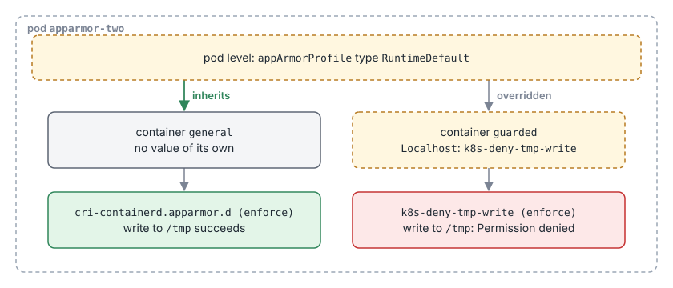

# Select A Profile With appArmorProfile

A loaded profile does nothing for a pod until the pod asks for it. In Kubernetes 1.35, the pod asks with the field `appArmorProfile` in a securityContext, the part of a pod or container specification that holds its security settings.

On this page, you learn the three types of the field and the difference between pod level and container level. You also see what the kubelet and the container runtime check before the container starts, and how to read the result from inside the container.

## The field and its types

The field `appArmorProfile` exists in two places. In the pod `securityContext`, it applies to every container. In the container `securityContext`, it overrides the pod value for that container. The field has a required `type`:

- `RuntimeDefault` applies the default AppArmor profile of the container runtime. It is the right start for most workloads, the same way `RuntimeDefault` is for seccomp.
- `Localhost` applies a profile that is already loaded on the node. The field `localhostProfile` holds the profile name, which is the word after `profile` in the file.
- `Unconfined` applies no AppArmor profile. The process is then limited only by the normal permissions and the other controls.

Older manifests use an annotation named `container.apparmor.security.beta.kubernetes.io/<container name>`. The annotation is deprecated. If a pod has both, the field wins, and new manifests should use only the field.

```yaml
securityContext:
  appArmorProfile:
    type: Localhost
    localhostProfile: k8s-deny-tmp-write
```

## What the kubelet and the runtime check

Two components check the profile before the container runs. The first is the kubelet, the component on each node that decides whether a pod may start there. For a pod with an AppArmor profile, it checks that the node supports AppArmor. On a node whose kernel has no AppArmor, the kubelet rejects the pod.

The second is the container runtime (containerd on this node), which then creates the container. For `Localhost`, it looks up the named profile in the kernel. If the profile is not loaded, the runtime returns an error and does not create the container. The pod then shows `CreateContainerError`, with a `Failed` event that names the profile.

If the profile is loaded, the runtime attaches it to the container process. From that point, the kernel enforces the profile, and the process cannot leave it. This is why a change of the profile for a running pod needs a new pod.


The drawing shows the check of the kubelet and then the check of the runtime. Only a pod that passes both runs its container under the profile.

## Use the profile in a pod

Now select a profile in a real pod. The playground is a virtual machine (VM) that runs a one-node Kubernetes 1.35 cluster built with kubeadm, and its kernel has AppArmor enabled. Open a shell on the VM from your own machine. You are then the user `student`, and `kubectl` points to the playground cluster:

<!-- astrona:playground:renew -->

```sh
astrona ssh astro-ats-033-playground-040-03
```

The pod below needs the profile `k8s-deny-tmp-write` loaded in the kernel of the node. The profile denies writes under `/tmp` and allows everything else. Its `signal` rule lets the runtime `runc` stop the container when you delete the pod. Save it as `k8s-deny-tmp-write`:

```text
#include <tunables/global>

profile k8s-deny-tmp-write flags=(attach_disconnected) {
  #include <abstractions/base>

  file,
  network,
  capability,
  # Let the container runtime (runc) stop the container.
  signal (receive) peer=runc,

  deny /tmp/** w,
}
```

Copy it into `/etc/apparmor.d`, load it, and check that the kernel has it in enforce mode. The VM is the node, so these node commands run in your shell with `sudo`. If the profile is already loaded, `apparmor_parser -r` replaces it, so the step is safe to repeat:

```sh
sudo cp k8s-deny-tmp-write /etc/apparmor.d/k8s-deny-tmp-write
sudo apparmor_parser -r /etc/apparmor.d/k8s-deny-tmp-write
sudo grep k8s-deny-tmp-write /sys/kernel/security/apparmor/profiles
```

```text
k8s-deny-tmp-write (enforce)
```

The next pod uses both levels of the field. It sets `RuntimeDefault` at pod level for all containers, and overrides it for one container with the custom profile. Save this as `pod-apparmor-container.yaml`:

```yaml
apiVersion: v1
kind: Pod
metadata:
  name: apparmor-two
  namespace: starfleet
spec:
  restartPolicy: Never
  securityContext:
    appArmorProfile:
      type: RuntimeDefault
  containers:
  - name: general
    image: docker.io/library/busybox:1.37.0
    command:
    - sh
    - -c
    - sleep 3600
  - name: guarded
    image: docker.io/library/busybox:1.37.0
    command:
    - sh
    - -c
    - sleep 3600
    securityContext:
      appArmorProfile:
        type: Localhost
        localhostProfile: k8s-deny-tmp-write
```

Apply it and wait for the pod:

```sh
kubectl apply -f pod-apparmor-container.yaml
kubectl -n starfleet wait --for=condition=Ready pod/apparmor-two --timeout=120s
```

Then read the profile that confines the main process of each container. The file `/proc/1/attr/current` contains the profile name and the mode in parentheses, or the word `unconfined`:

```sh
kubectl -n starfleet exec apparmor-two -c general -- cat /proc/1/attr/current
kubectl -n starfleet exec apparmor-two -c guarded -- cat /proc/1/attr/current
```

```text
cri-containerd.apparmor.d (enforce)
k8s-deny-tmp-write (enforce)
```

The first container reports `cri-containerd.apparmor.d`, the default profile that containerd loads, in enforce mode. The second reports `k8s-deny-tmp-write` in enforce mode. The container value replaced the pod value, but for `guarded` only.



The drawing shows how the two levels combine in `apparmor-two`. The `general` container keeps the pod value, and the `guarded` container uses its own value.

Now compare a write in the two containers. The second command is expected to fail, so run each on its own:

```sh
kubectl -n starfleet exec apparmor-two -c general -- sh -c 'echo test > /tmp/file'
kubectl -n starfleet exec apparmor-two -c guarded -- sh -c 'echo test > /tmp/file'
```

The first command prints nothing, because the write succeeds. The second prints this:

```text
sh: can't create /tmp/file: Permission denied
command terminated with exit code 1
```

Both containers run as root, and the file mode of `/tmp` allows the write. So the AppArmor profile, not the file permission, made the difference. Remove the pod:

```sh
kubectl -n starfleet delete pod apparmor-two
```

## When the profile is not available

A pod can also ask for a profile that the node does not have. In that case, the kubelet cannot start the container. The pod below asks for a profile named `k8s-not-loaded`, which no file on the node defines. Save this pod as `pod-apparmor-missing.yaml`:

```yaml
apiVersion: v1
kind: Pod
metadata:
  name: apparmor-missing
  namespace: starfleet
spec:
  restartPolicy: Never
  containers:
  - name: shell
    image: docker.io/library/busybox:1.37.0
    command:
    - sh
    - -c
    - sleep 3600
    securityContext:
      appArmorProfile:
        type: Localhost
        localhostProfile: k8s-not-loaded
```

Apply it:

```sh
kubectl apply -f pod-apparmor-missing.yaml
```

Then, after about ten seconds, check the result with the pod status and the events of the pod:

```sh
kubectl -n starfleet get pod apparmor-missing
kubectl -n starfleet describe pod apparmor-missing | sed -n '/^Events:/,$p'
```

```text
NAME               READY   STATUS                 RESTARTS   AGE
apparmor-missing   0/1     CreateContainerError   0          10s
Events:
  Type     Reason     Age                From               Message
  ----     ------     ----               ----               -------
  Normal   Scheduled  11s                default-scheduler  Successfully assigned starfleet/apparmor-missing to astro-ats-033-playground-040-03
  Normal   Pulled     10s (x2 over 10s)  kubelet            spec.containers{shell}: Container image "docker.io/library/busybox:1.37.0" already present on machine and can be accessed by the pod
  Warning  Failed     10s (x2 over 10s)  kubelet            spec.containers{shell}: Error: failed to get container spec opts: failed to generate apparmor spec opts: apparmor profile not found k8s-not-loaded
```

The scheduler placed the pod, and the kubelet tried to create the container. The container runtime (containerd) did not find the profile in the kernel. So the container never started, and the status is `CreateContainerError`. The `Warning` event names the missing profile. Delete the pod with `kubectl -n starfleet delete pod apparmor-missing`.

The repair is to load the profile on that node with `apparmor_parser -r`, or to schedule the pod on a node that has it. On a machine without AppArmor in the kernel, the repair is a different node or a different control, such as seccomp and dropped capabilities. It is never `Unconfined` to hide the error.

You can now select an AppArmor profile at the right level, and prove from inside the container which profile applies. AppArmor limits what the process can touch. The open question is how much root power the process itself still holds.

## Common pitfalls

> [!WARNING]
> - **Using the deprecated annotation.** New manifests use the `appArmorProfile` field.
> - **Mixing up the profile name and the file name.** `localhostProfile` is the name written inside the profile file.
> - **Forgetting the container override.** A container value replaces the pod value, so check both levels.
> - **Switching to `Unconfined` when the pod will not start.** Load the profile on the node instead.
> - **Editing a running pod and expecting a change.** The runtime attaches the profile when the container starts. Create a new pod.
> - **Writing a custom profile without a `signal` rule.** The runtime cannot stop the container, and a deleted pod stays in `Terminating`. Add `signal (receive) peer=runc,` and reload the profile.
